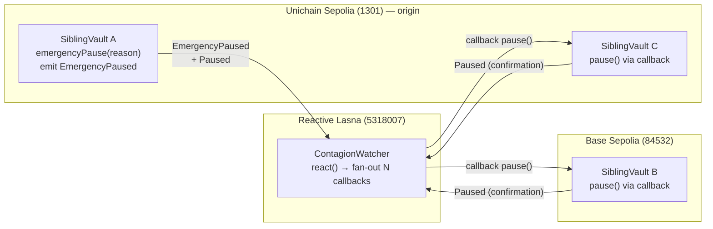
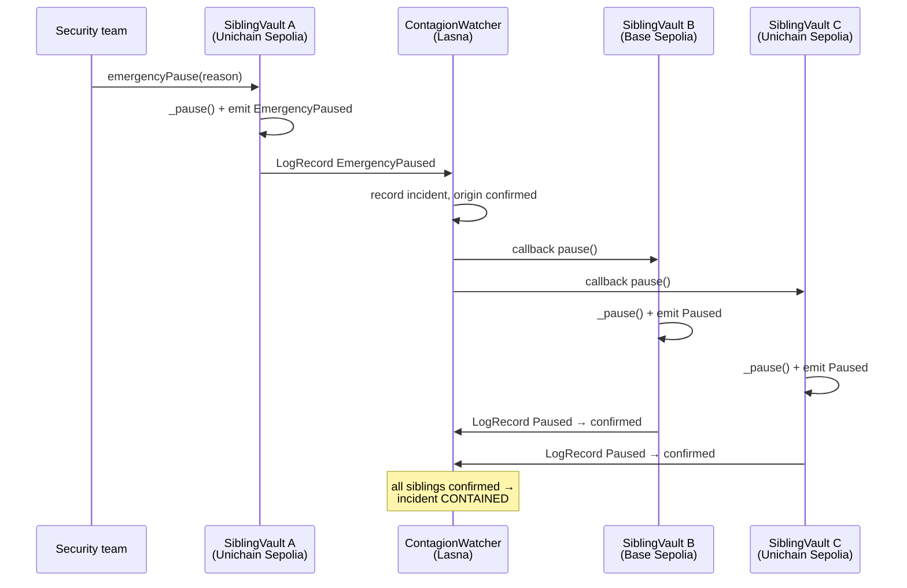

# ContagionStop — Cross-Chain Circuit Breaker

> **Multisig takes hours. This takes one block.**

[](https://sepolia.basescan.org)
[](https://sepolia.uniscan.xyz)
[](https://lasna.reactscan.net)
[](https://soliditylang.org)
[](https://book.getfoundry.sh)
[](LICENSE)

> **Status: testnet only. Not audited. Do not use with real funds.**
> All contract addresses, transaction hashes, and latency numbers below are
> **measured on testnet, 14–15 Nov 2026** (deploy + 5 loop scenarios, all passing;
> v2 ETH and USDC loops added 15 Nov).
> Full evidence: `VERIFICATION.md` + `deploy-log.md`.

---

No keeper, no oracle, no AI — pure Reactive: event → Lasna → callback fan-out.

---

## Problem

Serious DeFi protocols do not live on one chain: the same lending vault, the
same bridge, the same code is deployed on Base, Unichain, and a dozen other
chains — same code, same risk. When a vulnerability is found in one deployment,
the attacker does not stop there: they replay the same exploit against the
sibling deployments, because they know each one is paused manually by a
multisig that needs hours to gather — members spread across time zones, quorum
to reach, transactions to sign one by one.

The victims: **every user of the second and third deployment whose funds could
still have been saved** if the pause had happened in seconds, not hours. The
pattern is proven by real losses: the Ronin bridge exploit ($625M) and
Wormhole ($326M) showed that once a hole is known, contagion across
deployments is a real threat, not a hypothesis. The difference here: what
spreads is not stolen funds, but the attack itself — and the antidote is not
human speed, but contract speed.

**Why not multisig + an off-chain monitoring bot?** That is the status quo —
and it has two single points of failure: the bot must stay alive (server down
= nobody pauses), and the multisig must manage to gather (humans asleep =
nobody pauses). ContagionStop moves both jobs into contracts: the trigger is
an on-chain event verified from the protocol itself, the execution is a
Reactive callback that needs no server alive. The only human jobs left — and
deliberately left — are the decision to trip and the decision to unpause
(see below), because both decisions need judgement, not speed.

---

## Solution

ContagionStop is a cross-chain circuit breaker. When the security team pauses
one deployment — because an exploit was detected — a reactive contract on
Lasna catches the `EmergencyPaused` event and, in a single `react()`,
requests a `pause()` callback to **every** sibling deployment on other chains.
No funds move: only `deposit` / `borrow` / `mint` freeze on each sibling.
Only a human (the protocol team, per deployment, manually, after an audit)
can unpause — there is no automatic unpause, ever.

One line: **an exploit on one chain must freeze its sibling deployments
within seconds, without waiting for a human to wake up.**

---

## How it works

### Architecture





### The loop, step by step

1. **Setup.** Three `SiblingVault`s deployed and funded; watcher registered and
   active. Each vault accepts `deposit()` — all three `Active`.
2. **Trigger.** The security team (owner of vault A) calls
   `emergencyPause(reason)` on Unichain Sepolia. Vault A pauses itself and
   emits `EmergencyPaused(A, reason)`. No funds move.
3. **React.** The watcher receives the LogRecord on Lasna → `react()` records
   the incident (`trippedAt`, `reason`, `active = true`), marks A confirmed,
   and requests **2 callbacks** `pause()`: to B (Base Sepolia) and to C
   (Unichain Sepolia). One `react()` → 2 callbacks.
4. **Execute.** The Reactive Signer sends both callbacks through each chain's
   proxy. `pause()` on B and C: guards pass → `_pause()` → emits `Paused`.
   `deposit()` on B and C now reverts.
5. **Confirm.** The watcher receives LogRecord `Paused` from B and from C →
   `confirmedPaused[84532][B] = true`, `confirmedPaused[1301][C] = true` →
   all siblings confirmed → incident `active = false` (**CONTAINED**).
6. **Proof.** The dashboard shows the incident (origin A, reason, trippedAt),
   per-sibling status (A/B/C: Paused), and the 4 loop transaction hashes below
   — plus a post-pause `deposit()` attempt that reverts as proof of freezing.
7. **Close (manual, outside the loop).** After an audit, the owner of each
   vault calls `unpause()` on their own vault — the watcher is not involved
   and does not record it.

### Why this is technically hard (the answer to "it's just `pause()`")

The hard part is not `pause()` — it is **coordinating N chains that are not
atomic, not synchronous, and can fail partially**:

- **Fan-out from one `react()`.** No published Reactive example uses 1 event →
  N callbacks as its core pattern (published examples are generally 1 event →
  1 callback). `react()` gas is capped at 900,000; each
  `requestCallbackV_1_0` adds cost; the number of supported siblings is
  bounded by that budget — a limit to measure, not assume.
- **Per-destination confirmation that is not atomic.** The watcher tracks a
  `confirmedPaused[chainId][sibling]` matrix across chains and across time,
  with events that can arrive in any order — or not arrive at all. A
  distributed state machine, not "fire and forget".
- **Retry that is safe against duplication.** Telling "new incident" apart
  from "retry re-emit" from only the `active` flag + origin key: a wrong reset
  → duplicate callbacks to an already-paused sibling (wasted fees +
  confusing events); a retry misread as a new incident → `trippedAt`
  overwritten → latency metrics destroyed.
- **Fail-closed at every layer.** Any failure (callback failed, event lost,
  sibling already paused) ends in a SAFE state (paused) or a VISIBLE state
  (not confirmed yet, waiting for operator re-emit) — never in "thought safe
  but actually open".
- **Zero cost when idle.** No CRON, no polling — the watcher pays nothing when
  there is no incident. For a circuit breaker that (hopefully) almost never
  trips, that is the correct economics: expensive only when needed.

### Unpause is manual by design

> **"Unpause is manual by design. There is no automatic unpause path — anyone
> promising one is selling you a backdoor."**

`unpause()` is `onlyOwner`, per vault, one by one. There is no callback path
to `unpause()`, no auto-unpause timer, no watcher `resume()` that reopens
siblings. This is not a missing feature — it is a security decision: an
auto-unpause is a hole (an attacker who can trigger a trip can wait out or
trigger the reopen condition); reopening needs an audit (is the hole patched?
are the funds intact? is the attacker still positioned?) — no contract can
answer those questions. Closing needs seconds; opening needs judgement. Like
a household circuit breaker: it trips itself on a short circuit, and only a
human may flip it back after checking.

### The trigger is manual by design

> **"The trigger is manual by design. Automatic detection would be a
> griefing vector, not a feature."**

ContagionStop deliberately does **not** detect exploits itself. The trip is a
single on-chain call by the protocol's security owner —
`emergencyPause(reason)` on the origin vault — and what the system automates
is the part humans are slow at: freezing every sibling deployment at once,
in seconds. Three reasons:

- **Automatic detection can be weaponized.** Any signal that can pause a
  protocol automatically can be faked to pause it maliciously — a griefing
  vector that freezes user funds on demand. A manual trigger has no
  false-positive surface by construction: nothing pauses unless the owner
  decides it should.
- **Detection is not the bottleneck.** Exploits are noticed within minutes
  by the community, monitoring, and the protocol team. The slow part has
  always been the response: gathering a multisig across time zones to pause
  each deployment one by one, in hours. ContagionStop closes the slow part.
- **The trigger is not tied to a human.** Today it is `onlyOwner`, but
  nothing in the design requires a human finger on the button: the owner can
  hand the call to a monitoring contract, a keeper, or a guardian multisig,
  and the loop works identically. Manual is the safe default, not an
  architectural limit.

## What doesn't count as integration

- A frontend button that calls `pause()` directly. The dashboard never calls
  `pause()` itself; only the watcher contract's callback does, after a real
  `EmergencyPaused` LogRecord.
- A watcher that only alerts. ContagionStop has no alert-only mode: every
  trip ends in an executed `pause()` callback on each sibling, confirmed
  on-chain (`confirmedPaused`), or it stays visibly unconfirmed.
- A staged loop. Nothing in the loop is staged: the event, the `react()`
  execution, the callbacks, and the confirmations are all real testnet
  transactions (see "Full loop — transaction hashes" below). The dashboard
  shows two kinds of data, labeled in the UI: live reads (vault paused
  state, balances, watcher balance) and the recorded run #1 (incident,
  timeline, history) — a static snapshot of measured values, not
  live-polled data. The recorded-run switch only changes which recorded
  snapshot is shown; it sends no transaction.

---

## Contract addresses

>  **Deployed + Sourcify-verified `exact_match` (creation + runtime) on 14 Nov 2026.**
> All four production contracts verified; vault D is a test-only 4th vault
> (fall-through scenario, unregistered — see below).

| Contract | Chain | Address | Explorer |
|---|---|---|---|
| `SiblingVault` A (origin) | Unichain Sepolia (1301) | `0xb18A213bfa8c1888af39AF100d7dd54Aa376F7b5`  Sourcify exact_match | [Uniscan](https://sepolia.uniscan.xyz/address/0xb18A213bfa8c1888af39AF100d7dd54Aa376F7b5) |
| `SiblingVault` B | Base Sepolia (84532) | `0xa7e3ceb5686f8d3b03e688efdc6a5a64ed80ca4a`  Sourcify exact_match | [BaseScan](https://sepolia.basescan.org/address/0xa7e3ceb5686f8d3b03e688efdc6a5a64ed80ca4a) |
| `SiblingVault` C | Unichain Sepolia (1301) | `0xb07a380104ac093485566cfc964540b04518b354`  Sourcify exact_match | [Uniscan](https://sepolia.uniscan.xyz/address/0xb07a380104ac093485566cfc964540b04518b354) |
| `ContagionWatcher` | Lasna (5318007) | `0xb18a213bfa8c1888af39af100d7dd54aa376f7b5`  Sourcify exact_match | [Reactscan](https://lasna.reactscan.net/address/0xb18a213bfa8c1888af39af100d7dd54aa376f7b5) |
| `SiblingVault` D (test-only, unregistered) | Unichain Sepolia (1301) | `0x8fB4aae500D914a1876f06FfA7f74fE9A88cEf7a`  Sourcify exact_match | [Uniscan](https://sepolia.uniscan.xyz/address/0x8fB4aae500D914a1876f06FfA7f74fE9A88cEf7a) |
| Callback proxy (Base Sepolia) | Base Sepolia (84532) | `0x476F44b11F5C942c58f4c8E3d0300E5710743585`  verified | [BaseScan](https://sepolia.basescan.org/address/0x476F44b11F5C942c58f4c8E3d0300E5710743585) |
| Callback proxy (Unichain Sepolia) | Unichain Sepolia (1301) | `0x775c9B990ADe401060B78D0e98684eEf8d2466C1`  verified | [Uniscan](https://sepolia.uniscan.xyz/address/0x775c9B990ADe401060B78D0e98684eEf8d2466C1) |
| Lasna faucet (Base Sepolia) | Base Sepolia (84532) | `0x2afaFD298b23b62760711756088F75B7409f5967`  verified | 1 ETH → 100 lREACT, max 5 ETH/tx |

**Do NOT use** the old proxy `0x9299472A6399Fd1027ebF067571Eb3e3D7837FC4`
(pre-Omni material, May 2026).

---

## Vaults v2 — ERC-20 shares (ETH + USDC)

Shares are ERC-20 per vault. The v2 ETH vaults are ETH-native (ERC-4626
semantics, no WETH); withdraw stays open while paused. The v2 USDC vaults
hold canonical USDC (share `CSUSDC`, min deposit 1 USDC, 12 decimals
offset). One watcher v2 on Lasna watches all four v2 vaults. All
implementations and factories below are Sourcify-verified `exact_match`
(creation + runtime); the clones are canonical EIP-1167 minimal proxies of
the verified implementations. The full loop hashes for both are in the tables below.

| Contract | Chain | Address |
|---|---|---|
| `ContagionWatcher` v2 | Lasna (5318007) | `0xF5ad04cBbA9458b634a4cfc8668FCC2A254C7D4B` |
| `ContagionVault` v2 — origin (ETH) | Unichain Sepolia (1301) | `0xEe9a24C80460069877e9b9F28143ee4D138Cf5d8` |
| `ContagionVault` v2 — sibling (ETH) | Base Sepolia (84532) | `0xB86060EE2332BD6b3DC9310E88371AE8cA1382b0` |
| `ContagionVaultERC20` — USDC vault | Unichain Sepolia (1301) | `0xb1404336db799285787bfb8a61f91e2d93e1bbdd` |
| `ContagionVaultERC20` — USDC vault | Base Sepolia (84532) | `0xd476AFBE349FB7b07110dda8E167095B2A3cee39` |
| `VaultFactory` (ETH) | Unichain Sepolia (1301) | `0x8c48B129a6Fd000e43448830Df6834b0a5BAe7A3` |
| `VaultFactory` (ETH) | Base Sepolia (84532) | `0xE7bd21cB41c0475650069A19b6207a48cAe0F9E6` |
| `VaultFactoryERC20` (USDC) | Unichain Sepolia (1301) | `0xe7c4A7Cc927a2afd332B07A7f73A50EFd036F032` |
| `VaultFactoryERC20` (USDC) | Base Sepolia (84532) | `0xE16b002789590e1a8aFD3a4cE119d16b49ABDe77` |
| `ContagionVault` implementation (ETH) | Unichain Sepolia (1301) | `0xE732a6e1D7F70Dc9502f9e4eDEb026451d911661` |
| `ContagionVault` implementation (ETH) | Base Sepolia (84532) | `0x8809f72C2ce8Af6081D6540Ea7f1C3269F155968` |
| `ContagionVaultERC20` implementation (USDC) | Unichain Sepolia (1301) | `0xb50ABF8959097f7c8Da476671e97f6F30d781daA` |
| `ContagionVaultERC20` implementation (USDC) | Base Sepolia (84532) | `0xB394E38c8aeb4d8ea1244faE0c229e05089A7edD` |
| USDC (asset) | Unichain Sepolia (1301) | `0x31d0220469e10c4E71834a79b1f276d740d3768F` |
| USDC (asset) | Base Sepolia (84532) | `0x036CbD53842c5426634e7929541eC2318f3dCF7e` |

### Deploy transactions (15 Nov 2026)

| Tx | Chain | Hash |
|---|---|---|
| Implementation (USDC) | Unichain Sepolia | `0x9ee0c94b9675f964b147429518b5a071af5af06d388d80b9285662c40d959f85` (block 67874783) |
| Factory ERC-20 | Unichain Sepolia | `0x5befd17f2e27d895e418841a7db98045022402f4d9c8968d01a587f8dadfadae` (block 67874783) |
| Implementation (USDC) | Base Sepolia | `0x3e8fe2d69f5c132ae58464a0f18aac96619500c87657953f03d0184e028a5f1f` (block 59026768) |
| Factory ERC-20 | Base Sepolia | `0x68a1b8dfa32b4507aa944fca9d3b5dd37b3a5c262ac7e0edf51598738e668e51` (block 59026768) |
| createVault (USDC) | Unichain Sepolia | `0xcf998b6a32f9073df965482cea587d4b2bea51d74354675b76c5bbfc8ef06523` (block 67874904) |
| createVault (USDC) | Base Sepolia | `0x61cc48b75ac5eecf643d916aa0e88c90a50c4b09aa2e20683e297ae3481de704` (block 59027438) |
| registerSibling (USDC vault) | Lasna | `0x5e0155f1dfdd8f913b3c8e7c75a29fab11f68fa0f91a0b96cc6c42a6d98575e0` (block 8390928) |
| registerSibling (USDC vault) | Lasna | `0x672e9e145a4659b5a464efca94f6f6c088d2294c9174f72be1312910ea035e5e` (block 8390934) |
| Implementation (ETH) | Unichain Sepolia | `0x355c55c63aae2d612278a752eb25c2a62b6b7fc9d4a7ccde6ae56118cbc9a4cd` |
| Factory (ETH) | Unichain Sepolia | `0xdd2c4bdb4d292e2d4937262e000e3d56b8afd94afb0de2eb54e025387e79714e` |
| Implementation (ETH) | Base Sepolia | `0xa27a0f3a50cc4e0853000d7fb7345453aed83f678021fce8ace1f74df52ea799` |
| Factory (ETH) | Base Sepolia | `0xe3d2b6cd84417d568ecb234453517d322fc8223044fc4ec37ef7bfd1aa6c6b70` |
| Watcher v2 | Lasna | `0xc0d62eb29588f285ca32fa3eb1afecc9543fac500a9fd10bab3ab358ac4e24ce` |
| createVault (ETH) | Unichain Sepolia | `0xfe6dd7cf809079d7daafa3f88f08a4dad452d9242e55854a957d1838f8724883` |
| createVault (ETH) | Base Sepolia | `0x143653b783d675a01eef57a277d9311b9ca332e6dcaf02ff0b4c73523ba17ca4` |

### Full loop v2 (ETH) — E2E-V2-001, 15 Nov 2026

| Step | Chain | Tx hash |
|---|---|---|
| Trip `emergencyPause` (origin, Unichain) | Unichain Sepolia | `0x7c84025e613083831745d675b88d6bf3c01aeddf207bbe4ea6c0e748f24d40f2` (block 67871519) |
| `react()` (fan-out 1) | Lasna | `0x61fc8e180d845c11d95f0e3c75f51bc3220e3212e28a67e94cace846ab2eed35` (block 8387722, gas 325,228) |
| Callback `pause()` (Base sibling) | Base Sepolia | `0xa9325ee9b97ba5d340794f81c69ca39ad6e142d6761baff04f012b99170e6ab6` (block 59010397, gas 80,932) |
| Containment `react()` | Lasna | `0xb1b47ff1a3be386d7eddb47408d15847d2c8316011407f6ce6322aee7deb7b7d` (block 8387723) |

Trip-to-callback ~1 s; containment in the next Lasna block. Loop cost
0.0793974 lREACT. Withdraw while paused succeeds
(`0x12e0b97eec542e250f07284148a9803d2a4b07e6171f8c352f4f3d0ce419d6ad`,
block 59011012, 0.001 ETH out); a deposit while paused reverts
(`0xdf197f3180d27af98c43767a731ff7a363eabe9197c2b34e393f2c8de925df13`,
block 59010730, status `0x0`).

### Funding status — USDC vaults funded (15 Nov 2026)

Both USDC vaults hold **20 USDC each** (`totalAssets` 20,000,000, 20e18
shares), funded 15 Nov 2026 via `deposit()` after `approve` (Unichain
deposit `0x58f656994811d0afb3d52a9d8f2671ac2c9ef70548f83cd42df1cd108fbb9cf8`,
block 67877108; Base deposit
`0x5c02fc0f66e7fcd2ee18f29534e97adde3558379f702d134ddecf496d1495403`,
block 59038153). Each vault also holds **0.001 ETH** as a callback-fee
buffer (Unichain
`0xcddbeddada387f2f9a93e8cb751cc305f4840116dd4079b7b8489cbd4f0372e5`,
block 67877153; Base
`0xfed30e4b162cfb7cadae2895d0a7977785be091c6888cc7357d9ee99a4304a80`,
block 59038568). The buffer works as designed: after two full loops the
proxy debt on every vault is 0 and no manual `coverDebt()` was needed —
callback fees were paid from the vaults' ETH balances (~0.00000016 ETH
on Unichain, ~0.00000063 ETH on Base per callback). A post-loop deposit
of 1 USDC and withdraw of 1 USDC both succeeded (deposit
`0x02e471f6e9bf6bb41d99789cd16de7f9ec1974b61d216a4587730faaa52cd841`,
withdraw
`0x5469fd1cb85e576fa48ecc35a982e18c40cb25e6c29b4dda3ff30bc19c867f79`),
returning `totalAssets` to 20,000,000.

#### Full loop E2E-USDC-01 — origin ETH vault, 15 Nov 2026

Trip on the Unichain ETH v2 vault; one `react()` fanned out to **3**
destinations (USDC vault Unichain, ETH + USDC vaults Base) — fan-out 3,
proven on-chain.

| Step | Chain | Tx hash |
|---|---|---|
| Trip `emergencyPause` (reason E2E-USDC-01) | Unichain Sepolia | `0xf836639b43ac9befb4fb6cb231632f24cee4038ccabfce5328a21511358053eb` (block 67877324) |
| `react()` (3× `PauseRequested`) | Lasna | `0xf55bf6eac0cd5ef220c19850800e903f520715a64870ad0d099724190e39af22` (block 8393170, gas 222,610) |
| Callback `pause()` (USDC vault, Unichain) | Unichain Sepolia | `0x93182e78bd4a8f8aedcf8dd4596087325cfc926cd568b77558ce28cb34f16805` (block 67877326) |
| Callback `pause()` (ETH vault, Base) | Base Sepolia | `0x7d2dd9663c919178f7d3f336fd413298eba8b86a80005b63ff5d5dff1000c814` (block 59039425) |
| Callback `pause()` (USDC vault, Base) | Base Sepolia | `0x8f1537c483faa35785916bef4dd1ac588155e9492f28fd0c1e05e75a5998ae0d` (block 59039428) |

Containment ~2–3 s after the trip; loop cost 0.105642 lREACT.

#### Full loop E2E-USDC-02 — origin USDC vault, 15 Nov 2026

Trip on the Unichain USDC vault — the watcher reacts to
`EmergencyPaused` from a USDC vault exactly as from an ETH vault.

| Step | Chain | Tx hash |
|---|---|---|
| Trip `emergencyPause` (reason E2E-USDC-02) | Unichain Sepolia | `0xfe37a2ee5f674c38db96e29764ac89be10e8707a7d6bab5b70b72fa7e7d1a0dd` (block 67877922) |
| `react()` (3× `PauseRequested`) | Lasna | `0xe2d4c87d54eb0ae6cd48914e79069b8b1aefbf32072062e3191a8e7095462a14` (block 8393733) |
| Callback `pause()` (ETH vault, Unichain) | Unichain Sepolia | `0xe29e058300cdb3807f554ba5588a86999e424f67c54c08b9111087997b92ab17` (block 67877924) |
| Callback `pause()` (ETH vault, Base) | Base Sepolia | `0x4003fc79e76c3df4c20193a4c981eb2386bbec2e9f7f6aa894b747e1ac481064` (block 59042413) |
| Callback `pause()` (USDC vault, Base) | Base Sepolia | `0x7406bc5bdc29640735959c2b29ca55ca12e587d8f16dc595afd00cb3e0266d29` (block 59042415) |

Containment 8 s after the trip; loop cost 0.1210131 lREACT. Watcher v2
balance after both loops: 0.1939475 lREACT.

### Deploy your own vault

The app (Overview → Deploy your own) creates vaults from the deployed
factories: pick a chain and an asset (ETH/USDC), fill in owner, watcher,
share name/symbol, and min deposit, check the predicted vault address
(`predictVault` with the factory's live `vaultCount`), then send
`createVault` — a real transaction. An ETH vault needs a seed of at
least 0.001 ETH sent with the call; a USDC vault is non-payable and
starts empty. After creation the app shows the two remaining manual
steps: register the vault in the watcher (`registerSibling`, watcher
owner only) and fund it.

---

## Try it live — public test deployment

Anyone can trigger the full loop with an ordinary wallet — no owner role
needed. Three `PublicVault`s (the same `SiblingVault` code plus
permissionless `trip(bytes32)` + `reopen()`) and a separate public
`ContagionWatcher` on Lasna. The main deployment above is owner-only;
that is the product behavior. The public instance exists so the loop can
be tested by anybody.

Set v1 was replaced 15 Nov 2026 with the F1+F4 build (vaults below);
the old vaults were unregistered from the watcher. The RECORDED cycles
1 & 2 ran on the old vaults and are kept as this set's recorded history.

| Contract | Chain | Address |
|---|---|---|
| `PublicVault` U1 (origin) | Unichain Sepolia (1301) | `0xe427b13172dc65d9218c6067fc6fd89408b47a1a` |
| `PublicVault` U2 | Unichain Sepolia (1301) | `0xCa5F695215DFE4aB6b96d6FbEAfbC79d57d3DCEe` |
| `PublicVault` B | Base Sepolia (84532) | `0x589770D4F1785b0fD20fF0600727Fc4BC7781d52` |
| `ContagionWatcher` (public) | Lasna (5318007) | `0x73f6e9989057f060801d1ab7d57f6047ff6c5557` |

All four are Sourcify-verified `exact_match`. One full loop costs
~0.08–0.11 lREACT (measured); the public watcher holds 2.6584943 lREACT
at handover (15 Nov 2026, gelombang 2), about 29 loops, and each vault holds ~0.001 ETH
for callback fees.

### Public test deployment v2 — shares (15 Nov 2026)

A second public set runs the real v2 product: three `PublicVaultV2`
(ETH shares, CSV) + one `PublicVaultERC20` (USDC shares, CSUSDC, 20
USDC funded) under a new public watcher on Lasna. `trip()` /
`reopen()` are permissionless here too, with a 60-second trip cooldown
per vault. Deposits mint shares to your wallet.

| Contract | Chain | Address |
|---|---|---|
| `PublicVaultV2` Uni #0 (origin) | Unichain Sepolia (1301) | `0x1f14825bBCC1727C134B7396BA77A2B4C37A6535` |
| `PublicVaultV2` Uni #1 | Unichain Sepolia (1301) | `0x6297D51f2D267aA636C3A0B2C842C118CDBC09be` |
| `PublicVaultV2` Base #0 | Base Sepolia (84532) | `0x405aaB687EE6453161935cCe267d9F2D01eFa540` |
| `PublicVaultERC20` USDC (20 USDC) | Unichain Sepolia (1301) | `0xa363E9591CC85C4BDcc4F08c5e7711F5A792e043` |
| `ContagionWatcher` (public v2) | Lasna (5318007) | `0x4b44497bAD6c270462D0529FCe4E41A7e092669b` |

Implementations + factories (Sourcify `exact_match`): `PublicVaultV2`
Uni `0xD6f947E4B7Fc9EC5eD0C2078d982eFedBd5A5652`, factory Uni
`0x1Aa24e0F8d970C6c7b308724617E29b25FBB2Ac2`; `PublicVaultV2` Base
`0x100efb80D0067F2753C09855ac062A849c29439e`, factory Base
`0xb50ABF8959097f7c8Da476671e97f6F30d781daA`; `PublicVaultERC20` Uni
`0xf51Ac3C1b74407E58c5F9f4e91D2cEcC25FFbc08`, factory ERC20 Uni
`0xA22A250522C1CbD76F79AfE5a864bb238Cf05424`.

> **Address note — read with the chain.** The public v2 watcher above
> (Lasna, chain 5318007) shares its address
> `0x4b44497bAD6c270462D0529FCe4E41A7e092669b` with the retired v1 vault B
> on Base Sepolia (chain 84532). Addresses are per-chain, so there is no
> collision — but never show this address without its chain.

E2E v2 (15 Nov 2026): trip Uni #0
[`0xd7c4c39d385b024bfc43dc6f6425a8e7dc358ea402876e84e668de396cc84a0a`](https://sepolia.uniscan.xyz/tx/0xd7c4c39d385b024bfc43dc6f6425a8e7dc358ea402876e84e668de396cc84a0a)
(block 67886881) → all three ETH vaults paused, CONTAINED (0.1020317
lREACT). E2E USDC: trip the USDC vault
[`0xd4f340b468992f6651810de8c6882486c6bd64388d39a96a2e7d54f950389b49`](https://sepolia.uniscan.xyz/tx/0xd4f340b468992f6651810de8c6882486c6bd64388d39a96a2e7d54f950389b49)
(block 67887012) → all four vaults paused, CONTAINED (0.1278079
lREACT). The v2 watcher holds 1.7701604 lREACT at handover (15 Nov
2026, after both E2Es), about 13 loops at ~0.13 lREACT/loop.

Two-trip race (F1 verification, 15 Nov 2026, set v1 baru): trip U1
[`0x02ade27e58f9dedc445d15250dd5479a4e010b11f3c4a18035dc1673d3ef6648`](https://sepolia.uniscan.xyz/tx/0x02ade27e58f9dedc445d15250dd5479a4e010b11f3c4a18035dc1673d3ef6648)
(block 67886611) + trip U2
[`0xb1c08933920b0f7d50f3ccfe203157b2aab2f89348cf635e0b7613959971b50d`](https://sepolia.uniscan.xyz/tx/0xb1c08933920b0f7d50f3ccfe203157b2aab2f89348cf635e0b7613959971b50d)
(block 67886612) back-to-back before the first containment — both
incidents CONTAINED in the same Lasna transaction
[`0xfe667e3e0d499f1bb0570149dd260a100e247274a13edb8c1a232a84802e4b74`](https://lasna.reactscan.net/tx/0xfe667e3e0d499f1bb0570149dd260a100e247274a13edb8c1a232a84802e4b74)
(block 8401899).

coverDebt with real proxy debt (F8, 15 Nov 2026, scratch instance):
trip
[`0x1ae52ec08f4b515734d32e085e6c650df432ffd96fff19f3527a420f474e23a7`](https://sepolia.uniscan.xyz/tx/0x1ae52ec08f4b515734d32e085e6c650df432ffd96fff19f3527a420f474e23a7)
left vault S with 152.606.850.000 wei debt and its callback blocked;
`coverDebt()`
[`0xc559af0511cf8c25778a7d057d61fbb8398cf3402debd424086966dc35cfde10`](https://sepolia.uniscan.xyz/tx/0xc559af0511cf8c25778a7d057d61fbb8398cf3402debd424086966dc35cfde10)
(block 67887224) paid the debt to zero, and the retry
[`0x835f7c1fcb67e7f4ee13eb54e89096fde91501560733f8e5608b4bdadb083127`](https://sepolia.uniscan.xyz/tx/0x835f7c1fcb67e7f4ee13eb54e89096fde91501560733f8e5608b4bdadb083127)
(block 67887240) let the callback through — CONTAINED.

Fresh-wallet E2E for Deploy your own (15 Nov 2026): a fresh wallet
(not the deployer,
`0x4c97434A42a74a42b9A3EFfa38247B0B7F124A17`) created a vault from the
main ETH factory — created
`0xe0e566c8AAE37ab7fc33743DE46EC8ace721D5a4` exactly matched the Deploy
page prediction (createVault
[`0x00302761c519f27d8b233fde12ba388705110d7c0212b2eede2646a5edd1e7a2`](https://sepolia.uniscan.xyz/tx/0x00302761c519f27d8b233fde12ba388705110d7c0212b2eede2646a5edd1e7a2),
block 67891567) — then the deployer registered it in watcher v2
([`0xb65f38260744eea454152b87326a0300541224a9c6edd656bfb1493acc064963`](https://lasna.reactscan.net/tx/0xb65f38260744eea454152b87326a0300541224a9c6edd656bfb1493acc064963),
Lasna block 8406581), the fresh wallet deposited 0.001 ETH
([`0xe61917e638aa8ba33bd1c57e76c32466a92ecc52bfea60beb570bb5635fd8af0`](https://sepolia.uniscan.xyz/tx/0xe61917e638aa8ba33bd1c57e76c32466a92ecc52bfea60beb570bb5635fd8af0),
totalAssets 0.001 → 0.002 ETH, 1e21 shares) and tripped it
([`0xa18fd7e5076eba17a28d10b2647a43b3dd48afed7040a5107871a34bf17dcfac`](https://sepolia.uniscan.xyz/tx/0xa18fd7e5076eba17a28d10b2647a43b3dd48afed7040a5107871a34bf17dcfac),
block 67891623; react
[`0xac633113b81cca48c17e9738b8991fa00cba707df82feb51e41cbfc36da74dcc`](https://lasna.reactscan.net/tx/0xac633113b81cca48c17e9738b8991fa00cba707df82feb51e41cbfc36da74dcc),
Lasna 8406617; containment
[`0x1ec9243d0dc00a16822d1adba4dd62e94ccddd869e3a332bf7bc482d9ecda7af`](https://lasna.reactscan.net/tx/0x1ec9243d0dc00a16822d1adba4dd62e94ccddd869e3a332bf7bc482d9ecda7af),
Lasna 8406620; loop cost 0.1526463 lREACT for a 5-vault fan-out).
All five vaults were unpaused afterwards. The same wallet deposited 1
USDC into the public USDC vault
([`0x3c38e78c26327990451b1545e1b370a4c4bd56f1755ece9a921e21153b3c3cda`](https://sepolia.uniscan.xyz/tx/0x3c38e78c26327990451b1545e1b370a4c4bd56f1755ece9a921e21153b3c3cda),
block 67891700; totalAssets 20 → 21 USDC, 1e18 shares).

**Steps (also on the site, Overview → Try it live):**

**Judge quickstart — what you need.** No wallet is needed to look: live
balances, paused state, recorded runs, and transaction hashes are all
readable as-is. To press the interactive buttons (Trip incident, Test
deposit), connect a wallet holding testnet ETH on the vault's chain
(Unichain Sepolia or Base Sepolia) for gas; trying a USDC vault also
needs testnet USDC on that chain. Free faucets (limits change — each
faucet's own page is the final word): [Superchain faucet](https://console.optimism.io/faucet)
(test ETH for Unichain Sepolia and Base Sepolia, 0.01 test ETH every 24
hours), [Circle faucet](https://faucet.circle.com) (test USDC, 20 USDC
per claim), [Alchemy faucet, Base Sepolia](https://www.alchemy.com/faucets/base-sepolia)
(0.1 test ETH every 24 hours; the wallet needs at least 0.001 ETH on
Ethereum mainnet plus mainnet activity), [Coinbase Developer Platform faucet](https://portal.cdp.coinbase.com/products/faucet)
(test ETH and USDC for Base Sepolia; free CDP account required). No
faucet needs your seed phrase, only your public wallet address.

1. Connect a wallet and switch to the vault's chain (Unichain Sepolia for
   U1/U2, Base Sepolia for B). You need a little testnet ETH for gas.
2. Press **Trip incident** on a vault (U1 is the origin used in the
   recorded runs) and confirm. The reason is ASCII-padded bytes32 — the
   same encoding as the recorded public runs (TEST-001 / TEST-002).
3. Wait ~2 seconds. The watcher reacts and requests a pause callback to
   each of the other two vaults; all three vault cards flip to PAUSED.
   Press **Refresh live state** if the cards have not updated yet.
4. Verify on the explorers: open your trip hash, then the watcher on
   Reactscan. Recorded reference — cycle 1 (15 Nov 2026, wallet not owned
   by the deployer): trip
   [`0x9cb807fa07c2e29acebc113852f0532bbce3dcf76d7180179d458dbe62827a02`](https://sepolia.uniscan.xyz/tx/0x9cb807fa07c2e29acebc113852f0532bbce3dcf76d7180179d458dbe62827a02)
   → react
   [`0x5fbbc913603634354b3ba40f10ac170f96b8cebef2fe01072dbc264816bdc7dc`](https://lasna.reactscan.net/tx/0x5fbbc913603634354b3ba40f10ac170f96b8cebef2fe01072dbc264816bdc7dc)
   → callback U2
   [`0x7acc95dbfeb696d8195e2878e8902b05be15cee53ff5524b8a265093ab1b13e3`](https://sepolia.uniscan.xyz/tx/0x7acc95dbfeb696d8195e2878e8902b05be15cee53ff5524b8a265093ab1b13e3)
   → callback B
   [`0x7197499c90d1fdd47b07a5c04acef4bf2c1feb042017a2a0da908b88b4f2bdff`](https://sepolia.basescan.org/tx/0x7197499c90d1fdd47b07a5c04acef4bf2c1feb042017a2a0da908b88b4f2bdff)
   → contained in ~2 s. Cycle 2 (trip
   [`0xb4f59a603a8032495c22646c518a8bdfc709e1124acd04bb40eb18a13418a541`](https://sepolia.uniscan.xyz/tx/0xb4f59a603a8032495c22646c518a8bdfc709e1124acd04bb40eb18a13418a541))
   repeated the same loop.
5. Press **Reopen** on each vault to reset (any wallet can do this here).
6. Press **Test deposit() — 0.001 ETH** to confirm deposits work again.
   While a vault is paused the button is disabled: a deposit then would
   revert (`EnforcedPause`) — that revert is the freeze proof. A deposit
   to a paused vault is on record as a reverted transaction:
   [`0x78129ef96b1a9bb4de664ab81bfa25d14ef78acd8805f3c5ffa39ef0d3b3be0a`](https://sepolia.uniscan.xyz/tx/0x78129ef96b1a9bb4de664ab81bfa25d14ef78acd8805f3c5ffa39ef0d3b3be0a)
   (status 0x0). A test deposit stays in the public vault — withdraw is
   owner-only, so send only testnet dust you do not need back.

Full evidence: `public-deploy-log.md`.

---

## Full loop — transaction hashes

>  **Measured on testnet, 14 Nov 2026 (incident 1, reason `EXPLOIT-001`).**
> Four hashes, plus two revert proofs. All verifiable on the explorers above.

| # | Step | Chain | Tx hash |
|---|---|---|---|
| 1 | `emergencyPause` (trigger) | Unichain Sepolia | [`0xe9f11b6df0c2e2f8efc7929cce4aa0b7910e094c6defc18e1f59ddea427e2257`](https://sepolia.uniscan.xyz/tx/0xe9f11b6df0c2e2f8efc7929cce4aa0b7910e094c6defc18e1f59ddea427e2257) (block 67816030, T0 = 1794668458) |
| 2 | `react()` | Lasna | [`0x98dd6dad4b360201ebae842be7280ee0da47051dd4607b6cafac6ef73f21293a`](https://lasna.reactscan.net/tx/0x98dd6dad4b360201ebae842be7280ee0da47051dd4607b6cafac6ef73f21293a) (block 8335436, T1 = 1794668458, gas 349,263; one `react()` emits both `PauseRequested` events — fan-out 2) |
| 3 | Callback `pause()` B | Base Sepolia | [`0xe84c258d1ebc313c7fe19f016bfa0805ba28fe93dd61811e4544627b734c506b`](https://sepolia.basescan.org/tx/0xe84c258d1ebc313c7fe19f016bfa0805ba28fe93dd61811e4544627b734c506b) (block 58732960, T2a = 1794668460, gas 78,314) |
| 4 | Callback `pause()` C | Unichain Sepolia | [`0x60e534047a2e279cf8c3c9dcacc21d949ed396f773a6e9f82c1c8eab444e5912`](https://sepolia.uniscan.xyz/tx/0x60e534047a2e279cf8c3c9dcacc21d949ed396f773a6e9f82c1c8eab444e5912) (block 67816033, T2b = 1794668461, gas 78,304) |
| + | `deposit()` after pause — **reverted** (proof of freezing) | Base Sepolia | [`0x47c8e697935b07f03114277ae0f526d1f52e6e10240a631bc048e889ae03db76`](https://sepolia.basescan.org/tx/0x47c8e697935b07f03114277ae0f526d1f52e6e10240a631bc048e889ae03db76) (status `0x0`, block 58733692) |
| + | `deposit()` after pause — **reverted** (proof of freezing) | Unichain Sepolia | [`0xe1b8c9c9b259b28a031208a585a39ed89b1ce31333aa975d53b161726ae0a499`](https://sepolia.uniscan.xyz/tx/0xe1b8c9c9b259b28a031208a585a39ed89b1ce31333aa975d53b161726ae0a499) (status `0x0`, block 67816462) |

Containment confirmation: [`0xf73ce63e667c8d6223e4611d6ceed2af0425bd0b69d6e0e1222672c5f74a3d0c`](https://lasna.reactscan.net/tx/0xf73ce63e667c8d6223e4611d6ceed2af0425bd0b69d6e0e1222672c5f74a3d0c) (Lasna block 8335438, ts 1794668460 — `IncidentContained`, incident `active = false`, `trippedAt = 1794668458`).

Between tx (1) and tx (3)/(4) there is **no human-signed transaction** — only
the Lasna `react()` transaction executed by Reactive validators. That is the
proof that no human is in the execution path.

**More loops, same contracts:** incident 2 (`EXPLOIT-002`, trip
[`0x9f28948126ba3a025fbb1270f5e3b30e73cc56d15ae76c80fd92e6bf7e540051`](https://sepolia.uniscan.xyz/tx/0x9f28948126ba3a025fbb1270f5e3b30e73cc56d15ae76c80fd92e6bf7e540051),
react [`0xeb98e68cce71e7da3ffa33fff5f17a5748e1bc47ce8df329e752aacd5a53f837`](https://lasna.reactscan.net/tx/0xeb98e68cce71e7da3ffa33fff5f17a5748e1bc47ce8df329e752aacd5a53f837))
and incident 3 (`EXPLOIT-003`) — including a real retry after a debt-blocked
callback (see `VERIFICATION.md` / `deploy-log.md`). A 4th vault D was tripped
while unregistered and correctly ignored (no incident, no `react()`).

---

## Latency metrics (measured on testnet)

>  **Measured on testnet, 14 Nov 2026 (incident 1).**
> All values are block timestamps from explorers, never block counts
> (Base Sepolia ~200 ms/block, Unichain ~1 s/block — block counts mislead).
> **Full-loop latency = max(T2a, T2b) − T0** (the slowest destination — the
> honest number, not the fastest). Timestamps have 1-second granularity and
> cross-chain clocks can differ by ±1 s (incident 2: Lasna `trippedAt`
> 1794668924 vs Unichain trip block 1794668925).
>
> - **T0** — block timestamp of tx `emergencyPause` (Unichain Sepolia)
> - **T1** — block timestamp of tx `react()` (Lasna, Reactscan)
> - **T2a / T2b** — block timestamp of callback `pause()` receipt per chain

| # | Measurement | Start tx/block | End tx/block | Value |
|---|---|---|---|---|
| M1 | Full loop (trip → last sibling paused) | `0xe9f11b6d…` (emergencyPause, Unichain, block 67816030) | `0x60e53404…` (last Paused, block 67816033) | **3 seconds** |
| M2 | Event → `react()` | `0xe9f11b6d…` (T0 = 1794668458) | `0x98dd6dad…` (react, Lasna, block 8335436) | **0 seconds** (same second, < 1 s) |
| M3 | `react()` → callback (Base Sepolia) | `0x98dd6dad…` (react) | `0xe84c258d…` (pause B, block 58732960) | **2 seconds** |
| M4 | `react()` → callback (Unichain, sibling C) | `0x98dd6dad…` (react) | `0x60e53404…` (pause C, block 67816033) | **3 seconds** |
| M5 | Gas `react()` (fan-out 2) | — | `0x98dd6dad…` (react) | **349,263 gas** (< 900,000) |
| M6 | Gas callback `pause()` | — | `0xe84c258d…` / `0x60e53404…` | **78,314 / 78,304 gas** (< 200,000) |
| M7 | Full-loop cost | — | — | **~0.08–0.11 lREACT** per loop (measured; public test cycles: 0.1020317 and 0.0838159 lREACT) + **~0.00000061 ETH** callback fee per destination (charged to the sibling's balance) |
| M8 | Time until CONTAINED | `trippedAt` = 1794668458 | last confirmation = 1794668460 | **2 seconds** |
| M9 | Confirmation | — | — | **2 / 2 siblings confirmed** |

## Why no off-chain dependencies?

The trigger is **already on-chain** — an `EmergencyPaused` event emitted by
the protocol itself. Adding an off-chain keeper, oracle, or AI layer would
only add trust assumptions, subscription cost, and latency, for zero benefit.
The simpler, deterministic thing wins when the problem is genuinely on-chain.
Circuit breakers as a concept predate this project; what is specific here is
the Reactive-executed cross-chain fan-out — one event, N callbacks, confirmed
per destination. Proof: there is not one off-chain dependency in this repo (no
keeper, bot, oracle, or API key); the whole loop can be replayed from the 4
transaction hashes + contract state.

---

## Honest limitations

- **Retry needs an operator re-emit.** There is no automatic retry loop: if
  one destination is not confirmed, the origin owner must call
  `emergencyPause(reason)` again. The watcher then fans out only to the
  unconfirmed destinations, and `trippedAt`/`reason` are untouched. No CRON,
  no polling, no auto-retry — a deliberate trade (cheaper, auditable, and it
  cannot re-fire callbacks at a sibling whose `Paused` event was merely late).
- **Max callbacks per `react()` unverified.** The docs say "a single reactive
  transaction can request several callbacks" but publish no maximum number.
  Fan-out of 3 is proven on-chain by the v2/USDC loops (one `react()`
  emitted 3 `PauseRequested`); expanding to 5+ chains must be tested first.
- **Fail-closed on reorg.** The Reactive sequencer treats an event observed
  on the origin chain as canonical even if that chain later reorgs — a
  callback can fire from a transaction that ultimately disappears on the
  origin. Sibling contracts do **not** re-verify the incident in the callback:
  they cannot read Lasna or origin state on-chain, and for a circuit breaker
  the correct failure direction is fail-closed (a wrongly paused sibling
  costs delayed deposits until a manual unpause; a deployment left open
  during a real exploit costs all its funds). Mitigation: origin chains with
  fast finality (Unichain Sepolia ~1 s/block, Base Sepolia ~200 ms/block),
  and `trippedAt` uses `block.timestamp`, never `block.number`.
- **Two origins tripping almost simultaneously.** Keterbatasan yang
  diketahui (main set v1 + vault v2 utama, bytecode per 14–15 Nov 2026):
  bila dua vault trip berurutan sebelum incident pertama mencapai
  CONTAINED, konfirmasi Paused dari vault yang sudah paused tidak
  ter-emit, sehingga incident dapat tersangkut aktif sampai ada
  intervensi manual (unpause + emergencyPause ulang). Prosedur
  operator: jangan trip origin kedua sebelum incident pertama
  berstatus CONTAINED. Perbaikan sudah ada di kode repo
  (SiblingVault.pause() meng-emit ulang Paused) dan live di instance
  publik baru. Catatan F6: registerSibling tidak memeriksa code di
  chain tujuan (tidak mungkin dari Lasna) — verifikasi dilakukan
  off-chain (checklist app + cast code di chain tujuan sebelum
  register).
- **The watcher does not track unpause.** It does not subscribe `Unpaused` —
  unpause is a per-deployment human matter and the watcher has no action to
  take on it. An incident becomes CONTAINED when all siblings are confirmed
  paused, even if an owner later unpauses one by one.
- **Owner compromise is out of scope.** If the origin owner's key (in
  production: the security multisig) is compromised, the attacker can pause
  manually with or without ContagionStop. What ContagionStop protects against
  is an attacker *without* the owner key triggering anything — the emitter
  allowlist + `onlyOwner` trigger mean no such path exists.
- **Testnet only, not audited.** Do not use with real funds.

---

## Tech stack

| Layer | Choice |
|---|---|
| Contracts | Solidity 0.8.29, Foundry, `reactive-lib-omni` v0.1.0, OpenZeppelin v5 (`Pausable` + `Ownable`), `evm_version = "cancun"` |
| Chains | Lasna (5318007, watcher) · Unichain Sepolia (1301, origin A + sibling C) · Base Sepolia (84532, sibling B) |
| Callback gas limit | 200,000 per callback (proxy overhead measured 130,000; 150,000 is NOT enough) |
| Frontend | Next.js 16 + shadcn/ui + wagmi v2 + viem + Reown AppKit |
| Video | Xvfb + ffmpeg (headless VM), YouTube unlisted, < 3 min |

---

## Run the tests locally

```bash
git clone https://github.com/0xward/contagion-stop
cd contagion-stop
forge install
forge build
forge test                 # 198 tests (14 suites) must pass
forge test --gas-report    # measure actual gas of pause() vs the 200,000 limit
```

**Requirements:** Foundry ≥ 1.9.0, solc 0.8.29 (via Foundry), no network access
needed for unit tests — the system contract and callback proxy are
stand-ins in test doubles (`test/fixtures/`). No private key, no faucet, no
deploy is needed to run the tests.

**Deploy to testnet:** deploy scripts live in `script/` (Foundry). Funding:
±0.18 ETH Base Sepolia + ±0.05 ETH Unichain Sepolia + 10 lREACT; SepETH 0.

---

## Repo layout

```
reactive-contagion-stop/
├── foundry.toml                      # solc 0.8.29 + evm_version = "cancun"
├── remappings.txt                    # @reactive/ -> lib/reactive-lib-omni/
├── lib/
│   ├── reactive-lib-omni/            # official submodule v0.1.0 (commit 3ade0dc)
│   └── openzeppelin-contracts/        # Pausable + Ownable (v5)
├── src/
│   ├── SiblingVault.sol              # pausable vault + callback pause()
│   ├── ContagionVault.sol            # v2 ETH vault: ERC-20 shares, ERC-4626 semantics
│   ├── ContagionVaultERC20.sol       # v2 ERC-20-asset vault (USDC): ERC-20 shares
│   ├── VaultFactory.sol              # v2 ETH vault factory (EIP-1167 clones)
│   ├── VaultFactoryERC20.sol         # v2 ERC-20 vault factory (EIP-1167 clones)
│   ├── ContagionWatcher.sol          # Lasna — subscribe + fan-out + confirmation
│   ├── ContagionTopics.sol           # topic0 constants (keccak, programmatic)
│   └── PublicVault.sol               # permissionless trip/reopen (public test instance)
├── test/
│   ├── SiblingVault.t.sol
│   ├── ContagionVault.t.sol
│   ├── ContagionVaultERC20.t.sol
│   ├── ContagionWatcher.t.sol
│   ├── ContagionIntegration.t.sol    # local integration: trip → fan-out → CONTAINED
│   ├── ContagionVaultIntegration.t.sol
│   ├── ContagionVaultERC20Integration.t.sol
│   ├── VaultFactory.t.sol
│   ├── VaultFactoryERC20.t.sol
│   ├── PublicVault.t.sol
│   ├── ContagionTopics.t.sol
│   ├── GasReport.t.sol
│   └── fixtures/                     # LocalSystemContract, LocalCallbackProxy
├── script/
│   ├── DeploySibling.s.sol
│   ├── DeployLasna.s.sol
│   ├── DeployVaultV2.s.sol
│   ├── CreateVaultV2.s.sol
│   ├── DeployVaultERC20.s.sol
│   ├── CreateVaultERC20.s.sol
│   ├── DeployPublicVaults.s.sol
│   ├── DeployPublicWatcher.s.sol
│   ├── Fund.s.sol
│   └── FundPublic.s.sol
├── frontend/                         # Next.js app: dashboard, deploy-your-own, try-it-live
│   └── src/                          # app/, components/, features/, hooks/, lib/
├── README.md
└── VERIFICATION.md                   # loop reproduction steps + tx hashes
```

---

## AI assistance disclosure

AI tools were used to assist in building this project — coding, research,
and review. This is a voluntary disclosure: every contract, test, and
on-chain measurement in this repo was checked against the deployed
contracts and the public explorers, and the evidence in `VERIFICATION.md`
stands on its own. No part of the loop depends on an AI system at runtime.

---

## License

MIT — see `LICENSE`.

---

*Original code. Testnet only, not audited.*
