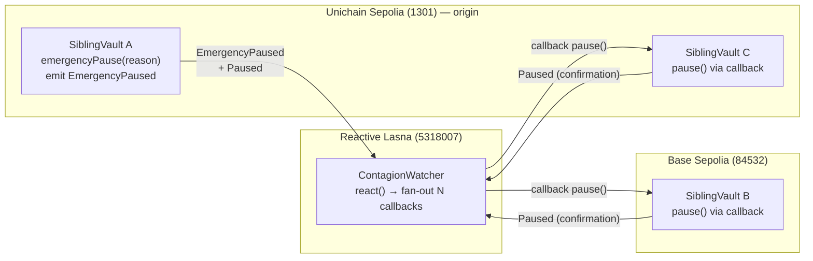
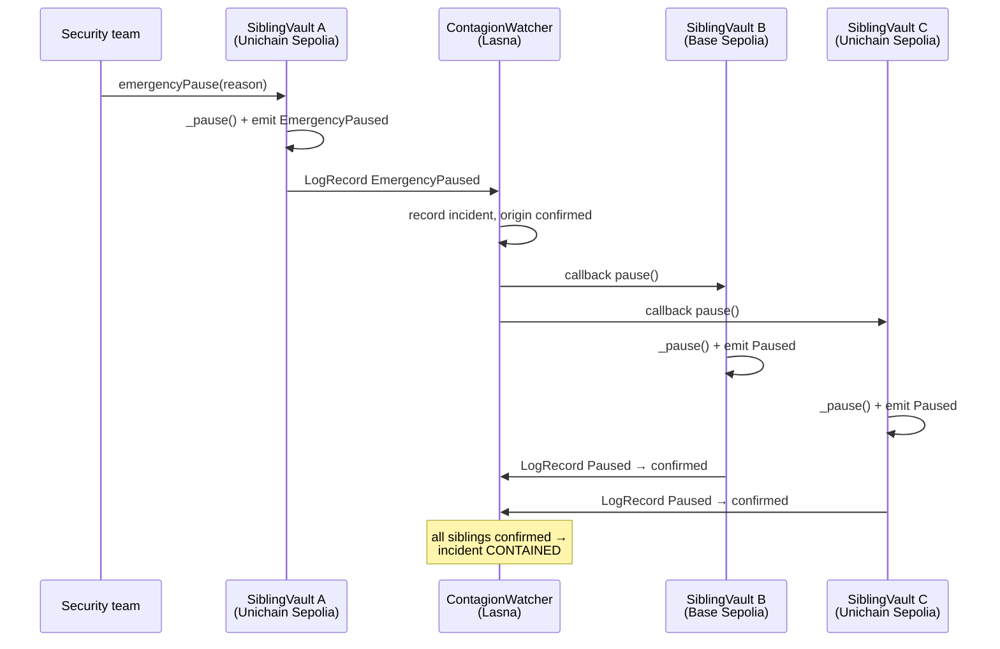

# ContagionStop — Cross-Chain Circuit Breaker

> **Multisig takes hours. This takes one block.**

[](https://sepolia.basescan.org)
[](https://sepolia.uniscan.xyz)
[](https://lasna.reactscan.net)
[](https://soliditylang.org)
[](https://book.getfoundry.sh)
[](LICENSE)

> **Status: testnet only. Not audited. Do not use with real funds.**
> All contract addresses, transaction hashes, and latency numbers below are
> **measured on testnet, 14 Nov 2026** (deploy + 5 loop scenarios, all passing).
> Full evidence: `VERIFICATION.md` + `deploy-log.md`.

---

No keeper, no oracle, no AI — pure Reactive: event → Lasna → callback fan-out.

---

## Problem

Serious DeFi protocols do not live on one chain: the same lending vault, the
same bridge, the same code is deployed on Base, Unichain, and a dozen other
chains — same code, same risk. When a vulnerability is found in one deployment,
the attacker does not stop there: they replay the same exploit against the
sibling deployments, because they know each one is paused manually by a
multisig that needs hours to gather — members spread across time zones, quorum
to reach, transactions to sign one by one.

The victims: **every user of the second and third deployment whose funds could
still have been saved** if the pause had happened in seconds, not hours. The
pattern is proven by real losses: the Ronin bridge exploit ($625M) and
Wormhole ($326M) showed that once a hole is known, contagion across
deployments is a real threat, not a hypothesis. The difference here: what
spreads is not stolen funds, but the attack itself — and the antidote is not
human speed, but contract speed.

**Why not multisig + an off-chain monitoring bot?** That is the status quo —
and it has two single points of failure: the bot must stay alive (server down
= nobody pauses), and the multisig must manage to gather (humans asleep =
nobody pauses). ContagionStop moves both jobs into contracts: the trigger is
an on-chain event verified from the protocol itself, the execution is a
Reactive callback that needs no server alive. The only human jobs left — and
deliberately left — are the decision to trip and the decision to unpause
(see below), because both decisions need judgement, not speed.

---

## Solution

ContagionStop is a cross-chain circuit breaker. When the security team pauses
one deployment — because an exploit was detected — a reactive contract on
Lasna catches the `EmergencyPaused` event and, in a single `react()`,
requests a `pause()` callback to **every** sibling deployment on other chains.
No funds move: only `deposit` / `borrow` / `mint` freeze on each sibling.
Only a human (the protocol team, per deployment, manually, after an audit)
can unpause — there is no automatic unpause, ever.

One line: **an exploit on one chain must freeze its sibling deployments
within seconds, without waiting for a human to wake up.**

---

## How it works

### Architecture





### The loop, step by step

1. **Setup.** Three `SiblingVault`s deployed and funded; watcher registered and
   active. Each vault accepts `deposit()` — all three `Active`.
2. **Trigger.** The security team (owner of vault A) calls
   `emergencyPause(reason)` on Unichain Sepolia. Vault A pauses itself and
   emits `EmergencyPaused(A, reason)`. No funds move.
3. **React.** The watcher receives the LogRecord on Lasna → `react()` records
   the incident (`trippedAt`, `reason`, `active = true`), marks A confirmed,
   and requests **2 callbacks** `pause()`: to B (Base Sepolia) and to C
   (Unichain Sepolia). One `react()` → 2 callbacks.
4. **Execute.** The Reactive Signer sends both callbacks through each chain's
   proxy. `pause()` on B and C: guards pass → `_pause()` → emits `Paused`.
   `deposit()` on B and C now reverts.
5. **Confirm.** The watcher receives LogRecord `Paused` from B and from C →
   `confirmedPaused[84532][B] = true`, `confirmedPaused[1301][C] = true` →
   all siblings confirmed → incident `active = false` (**CONTAINED**).
6. **Proof.** The dashboard shows the incident (origin A, reason, trippedAt),
   per-sibling status (A/B/C: Paused), and the 4 loop transaction hashes below
   — plus a post-pause `deposit()` attempt that reverts as proof of freezing.
7. **Close (manual, outside the loop).** After an audit, the owner of each
   vault calls `unpause()` on their own vault — the watcher is not involved
   and does not record it.

### Why this is technically hard (the answer to "it's just `pause()`")

The hard part is not `pause()` — it is **coordinating N chains that are not
atomic, not synchronous, and can fail partially**:

- **Fan-out from one `react()`.** No published Reactive example uses 1 event →
  N callbacks as its core pattern (published examples are generally 1 event →
  1 callback). `react()` gas is capped at 900,000; each
  `requestCallbackV_1_0` adds cost; the number of supported siblings is
  bounded by that budget — a limit to measure, not assume.
- **Per-destination confirmation that is not atomic.** The watcher tracks a
  `confirmedPaused[chainId][sibling]` matrix across chains and across time,
  with events that can arrive in any order — or not arrive at all. A
  distributed state machine, not "fire and forget".
- **Retry that is safe against duplication.** Telling "new incident" apart
  from "retry re-emit" from only the `active` flag + origin key: a wrong reset
  → duplicate callbacks to an already-paused sibling (wasted fees +
  confusing events); a retry misread as a new incident → `trippedAt`
  overwritten → latency metrics destroyed.
- **Fail-closed at every layer.** Any failure (callback failed, event lost,
  sibling already paused) ends in a SAFE state (paused) or a VISIBLE state
  (not confirmed yet, waiting for operator re-emit) — never in "thought safe
  but actually open".
- **Zero cost when idle.** No CRON, no polling — the watcher pays nothing when
  there is no incident. For a circuit breaker that (hopefully) almost never
  trips, that is the correct economics: expensive only when needed.

### Unpause is manual by design

> **"Unpause is manual by design. There is no automatic unpause path — anyone
> promising one is selling you a backdoor."**

`unpause()` is `onlyOwner`, per vault, one by one. There is no callback path
to `unpause()`, no auto-unpause timer, no watcher `resume()` that reopens
siblings. This is not a missing feature — it is a security decision: an
auto-unpause is a hole (an attacker who can trigger a trip can wait out or
trigger the reopen condition); reopening needs an audit (is the hole patched?
are the funds intact? is the attacker still positioned?) — no contract can
answer those questions. Closing needs seconds; opening needs judgement. Like
a household circuit breaker: it trips itself on a short circuit, and only a
human may flip it back after checking.

### The trigger is manual by design

> **"The trigger is manual by design. Automatic detection would be a
> griefing vector, not a feature."**

ContagionStop deliberately does **not** detect exploits itself. The trip is a
single on-chain call by the protocol's security owner —
`emergencyPause(reason)` on the origin vault — and what the system automates
is the part humans are slow at: freezing every sibling deployment at once,
in seconds. Three reasons:

- **Automatic detection can be weaponized.** Any signal that can pause a
  protocol automatically can be faked to pause it maliciously — a griefing
  vector that freezes user funds on demand. A manual trigger has no
  false-positive surface by construction: nothing pauses unless the owner
  decides it should.
- **Detection is not the bottleneck.** Exploits are noticed within minutes
  by the community, monitoring, and the protocol team. The slow part has
  always been the response: gathering a multisig across time zones to pause
  each deployment one by one, in hours. ContagionStop closes the slow part.
- **The trigger is not tied to a human.** Today it is `onlyOwner`, but
  nothing in the design requires a human finger on the button: the owner can
  hand the call to a monitoring contract, a keeper, or a guardian multisig,
  and the loop works identically. Manual is the safe default, not an
  architectural limit.

## What doesn't count as integration

- A frontend button that calls `pause()` directly. The dashboard never calls
  `pause()` itself; only the watcher contract's callback does, after a real
  `EmergencyPaused` LogRecord.
- A watcher that only alerts. ContagionStop has no alert-only mode: every
  trip ends in an executed `pause()` callback on each sibling, confirmed
  on-chain (`confirmedPaused`), or it stays visibly unconfirmed.
- A staged loop. Nothing in the loop is staged: the event, the `react()`
  execution, the callbacks, and the confirmations are all real testnet
  transactions (see "Full loop — transaction hashes" below). The dashboard
  shows two kinds of data, labeled in the UI: live reads (vault paused
  state, balances, watcher balance) and the recorded run #1 (incident,
  timeline, history) — a static snapshot of measured values, not
  live-polled data. The recorded-run switch only changes which recorded
  snapshot is shown; it sends no transaction.

---

## Contract addresses

>  **Deployed + Sourcify-verified `exact_match` (creation + runtime) on 14 Nov 2026.**
> All four production contracts verified; vault D is a test-only 4th vault
> (fall-through scenario, unregistered — see below).

| Contract | Chain | Address | Explorer |
|---|---|---|---|
| `SiblingVault` A (origin) | Unichain Sepolia (1301) | `0xb18A213bfa8c1888af39AF100d7dd54Aa376F7b5`  Sourcify exact_match | [Uniscan](https://sepolia.uniscan.xyz/address/0xb18A213bfa8c1888af39AF100d7dd54Aa376F7b5) |
| `SiblingVault` B | Base Sepolia (84532) | `0xa7e3ceb5686f8d3b03e688efdc6a5a64ed80ca4a`  Sourcify exact_match | [BaseScan](https://sepolia.basescan.org/address/0xa7e3ceb5686f8d3b03e688efdc6a5a64ed80ca4a) |
| `SiblingVault` C | Unichain Sepolia (1301) | `0xb07a380104ac093485566cfc964540b04518b354`  Sourcify exact_match | [Uniscan](https://sepolia.uniscan.xyz/address/0xb07a380104ac093485566cfc964540b04518b354) |
| `ContagionWatcher` | Lasna (5318007) | `0xb18a213bfa8c1888af39af100d7dd54aa376f7b5`  Sourcify exact_match | [Reactscan](https://lasna.reactscan.net/address/0xb18a213bfa8c1888af39af100d7dd54aa376f7b5) |
| `SiblingVault` D (test-only, unregistered) | Unichain Sepolia (1301) | `0x8fB4aae500D914a1876f06FfA7f74fE9A88cEf7a`  Sourcify exact_match | [Uniscan](https://sepolia.uniscan.xyz/address/0x8fB4aae500D914a1876f06FfA7f74fE9A88cEf7a) |
| Callback proxy (Base Sepolia) | Base Sepolia (84532) | `0x476F44b11F5C942c58f4c8E3d0300E5710743585`  verified | [BaseScan](https://sepolia.basescan.org/address/0x476F44b11F5C942c58f4c8E3d0300E5710743585) |
| Callback proxy (Unichain Sepolia) | Unichain Sepolia (1301) | `0x775c9B990ADe401060B78D0e98684eEf8d2466C1`  verified | [Uniscan](https://sepolia.uniscan.xyz/address/0x775c9B990ADe401060B78D0e98684eEf8d2466C1) |
| Lasna faucet (Base Sepolia) | Base Sepolia (84532) | `0x2afaFD298b23b62760711756088F75B7409f5967`  verified | 1 ETH → 100 lREACT, max 5 ETH/tx |

**Do NOT use** the old proxy `0x9299472A6399Fd1027ebF067571Eb3e3D7837FC4`
(pre-Omni material, May 2026).

---

## Try it live — public test deployment

Anyone can trigger the full loop with an ordinary wallet — no owner role
needed. Three `PublicVault`s (the same `SiblingVault` code plus
permissionless `trip(bytes32)` + `reopen()`) and a separate public
`ContagionWatcher` on Lasna. The main deployment above is owner-only;
that is the product behavior. The public instance exists so the loop can
be tested by anybody.

| Contract | Chain | Address |
|---|---|---|
| `PublicVault` U1 (origin) | Unichain Sepolia (1301) | `0x2bd64b3ee79eb1f38191e0b185786cb176d8696c` |
| `PublicVault` U2 | Unichain Sepolia (1301) | `0xf3475038bc53aa50408272F233F5dF73F6CF8F8c` |
| `PublicVault` B | Base Sepolia (84532) | `0x4b44497bAD6c270462D0529FCe4E41A7e092669b` |
| `ContagionWatcher` (public) | Lasna (5318007) | `0x73f6e9989057f060801d1ab7d57f6047ff6c5557` |

All four are Sourcify-verified `exact_match`. One full loop costs
~0.08–0.11 lREACT (measured); the public watcher holds 1.9141524 lREACT
at handover (15 Nov 2026), about 20 loops, and each vault holds ~0.001 ETH
for callback fees.

**Steps (also on the site, Overview → Try it live):**

1. Connect a wallet and switch to the vault's chain (Unichain Sepolia for
   U1/U2, Base Sepolia for B). You need a little testnet ETH for gas.
2. Press **Trip incident** on a vault (U1 is the origin used in the
   recorded runs) and confirm. The reason is ASCII-padded bytes32 — the
   same encoding as the recorded public runs (TEST-001 / TEST-002).
3. Wait ~2 seconds. The watcher reacts and requests a pause callback to
   each of the other two vaults; all three vault cards flip to PAUSED.
   Press **Refresh live state** if the cards have not updated yet.
4. Verify on the explorers: open your trip hash, then the watcher on
   Reactscan. Recorded reference — cycle 1 (15 Nov 2026, wallet not owned
   by the deployer): trip
   [`0x9cb807fa07c2e29acebc113852f0532bbce3dcf76d7180179d458dbe62827a02`](https://sepolia.uniscan.xyz/tx/0x9cb807fa07c2e29acebc113852f0532bbce3dcf76d7180179d458dbe62827a02)
   → react
   [`0x5fbbc913603634354b3ba40f10ac170f96b8cebef2fe01072dbc264816bdc7dc`](https://lasna.reactscan.net/tx/0x5fbbc913603634354b3ba40f10ac170f96b8cebef2fe01072dbc264816bdc7dc)
   → callback U2
   [`0x7acc95dbfeb696d8195e2878e8902b05be15cee53ff5524b8a265093ab1b13e3`](https://sepolia.uniscan.xyz/tx/0x7acc95dbfeb696d8195e2878e8902b05be15cee53ff5524b8a265093ab1b13e3)
   → callback B
   [`0x7197499c90d1fdd47b07a5c04acef4bf2c1feb042017a2a0da908b88b4f2bdff`](https://sepolia.basescan.org/tx/0x7197499c90d1fdd47b07a5c04acef4bf2c1feb042017a2a0da908b88b4f2bdff)
   → contained in ~2 s. Cycle 2 (trip
   [`0xb4f59a603a8032495c22646c518a8bdfc709e1124acd04bb40eb18a13418a541`](https://sepolia.uniscan.xyz/tx/0xb4f59a603a8032495c22646c518a8bdfc709e1124acd04bb40eb18a13418a541))
   repeated the same loop.
5. Press **Reopen** on each vault to reset (any wallet can do this here).
6. Press **Test deposit() — 0.001 ETH** to confirm deposits work again.
   While a vault is paused the button is disabled: a deposit then would
   revert (`EnforcedPause`) — that revert is the freeze proof. A deposit
   to a paused vault is on record as a reverted transaction:
   [`0x78129ef96b1a9bb4de664ab81bfa25d14ef78acd8805f3c5ffa39ef0d3b3be0a`](https://sepolia.uniscan.xyz/tx/0x78129ef96b1a9bb4de664ab81bfa25d14ef78acd8805f3c5ffa39ef0d3b3be0a)
   (status 0x0). A test deposit stays in the public vault — withdraw is
   owner-only, so send only testnet dust you do not need back.

Full evidence: `public-deploy-log.md`.

---

## Full loop — transaction hashes

>  **Measured on testnet, 14 Nov 2026 (incident 1, reason `EXPLOIT-001`).**
> Four hashes, plus two revert proofs. All verifiable on the explorers above.

| # | Step | Chain | Tx hash |
|---|---|---|---|
| 1 | `emergencyPause` (trigger) | Unichain Sepolia | [`0xe9f11b6df0c2e2f8efc7929cce4aa0b7910e094c6defc18e1f59ddea427e2257`](https://sepolia.uniscan.xyz/tx/0xe9f11b6df0c2e2f8efc7929cce4aa0b7910e094c6defc18e1f59ddea427e2257) (block 67816030, T0 = 1794668458) |
| 2 | `react()` | Lasna | [`0x98dd6dad4b360201ebae842be7280ee0da47051dd4607b6cafac6ef73f21293a`](https://lasna.reactscan.net/tx/0x98dd6dad4b360201ebae842be7280ee0da47051dd4607b6cafac6ef73f21293a) (block 8335436, T1 = 1794668458, gas 349,263; one `react()` emits both `PauseRequested` events — fan-out 2) |
| 3 | Callback `pause()` B | Base Sepolia | [`0xe84c258d1ebc313c7fe19f016bfa0805ba28fe93dd61811e4544627b734c506b`](https://sepolia.basescan.org/tx/0xe84c258d1ebc313c7fe19f016bfa0805ba28fe93dd61811e4544627b734c506b) (block 58732960, T2a = 1794668460, gas 78,314) |
| 4 | Callback `pause()` C | Unichain Sepolia | [`0x60e534047a2e279cf8c3c9dcacc21d949ed396f773a6e9f82c1c8eab444e5912`](https://sepolia.uniscan.xyz/tx/0x60e534047a2e279cf8c3c9dcacc21d949ed396f773a6e9f82c1c8eab444e5912) (block 67816033, T2b = 1794668461, gas 78,304) |
| + | `deposit()` after pause — **reverted** (proof of freezing) | Base Sepolia | [`0x47c8e697935b07f03114277ae0f526d1f52e6e10240a631bc048e889ae03db76`](https://sepolia.basescan.org/tx/0x47c8e697935b07f03114277ae0f526d1f52e6e10240a631bc048e889ae03db76) (status `0x0`, block 58733692) |
| + | `deposit()` after pause — **reverted** (proof of freezing) | Unichain Sepolia | [`0xe1b8c9c9b259b28a031208a585a39ed89b1ce31333aa975d53b161726ae0a499`](https://sepolia.uniscan.xyz/tx/0xe1b8c9c9b259b28a031208a585a39ed89b1ce31333aa975d53b161726ae0a499) (status `0x0`, block 67816462) |

Containment confirmation: [`0xf73ce63e667c8d6223e4611d6ceed2af0425bd0b69d6e0e1222672c5f74a3d0c`](https://lasna.reactscan.net/tx/0xf73ce63e667c8d6223e4611d6ceed2af0425bd0b69d6e0e1222672c5f74a3d0c) (Lasna block 8335438, ts 1794668460 — `IncidentContained`, incident `active = false`, `trippedAt = 1794668458`).

Between tx (1) and tx (3)/(4) there is **no human-signed transaction** — only
the Lasna `react()` transaction executed by Reactive validators. That is the
proof that no human is in the execution path.

**More loops, same contracts:** incident 2 (`EXPLOIT-002`, trip
[`0x9f28948126ba3a025fbb1270f5e3b30e73cc56d15ae76c80fd92e6bf7e540051`](https://sepolia.uniscan.xyz/tx/0x9f28948126ba3a025fbb1270f5e3b30e73cc56d15ae76c80fd92e6bf7e540051),
react [`0xeb98e68cce71e7da3ffa33fff5f17a5748e1bc47ce8df329e752aacd5a53f837`](https://lasna.reactscan.net/tx/0xeb98e68cce71e7da3ffa33fff5f17a5748e1bc47ce8df329e752aacd5a53f837))
and incident 3 (`EXPLOIT-003`) — including a real retry after a debt-blocked
callback (see `VERIFICATION.md` / `deploy-log.md`). A 4th vault D was tripped
while unregistered and correctly ignored (no incident, no `react()`).

---

## Latency metrics (measured on testnet)

>  **Measured on testnet, 14 Nov 2026 (incident 1).**
> All values are block timestamps from explorers, never block counts
> (Base Sepolia ~200 ms/block, Unichain ~1 s/block — block counts mislead).
> **Full-loop latency = max(T2a, T2b) − T0** (the slowest destination — the
> honest number, not the fastest). Timestamps have 1-second granularity and
> cross-chain clocks can differ by ±1 s (incident 2: Lasna `trippedAt`
> 1794668924 vs Unichain trip block 1794668925).
>
> - **T0** — block timestamp of tx `emergencyPause` (Unichain Sepolia)
> - **T1** — block timestamp of tx `react()` (Lasna, Reactscan)
> - **T2a / T2b** — block timestamp of callback `pause()` receipt per chain

| # | Measurement | Start tx/block | End tx/block | Value |
|---|---|---|---|---|
| M1 | Full loop (trip → last sibling paused) | `0xe9f11b6d…` (emergencyPause, Unichain, block 67816030) | `0x60e53404…` (last Paused, block 67816033) | **3 seconds** |
| M2 | Event → `react()` | `0xe9f11b6d…` (T0 = 1794668458) | `0x98dd6dad…` (react, Lasna, block 8335436) | **0 seconds** (same second, < 1 s) |
| M3 | `react()` → callback (Base Sepolia) | `0x98dd6dad…` (react) | `0xe84c258d…` (pause B, block 58732960) | **2 seconds** |
| M4 | `react()` → callback (Unichain, sibling C) | `0x98dd6dad…` (react) | `0x60e53404…` (pause C, block 67816033) | **3 seconds** |
| M5 | Gas `react()` (fan-out 2) | — | `0x98dd6dad…` (react) | **349,263 gas** (< 900,000) |
| M6 | Gas callback `pause()` | — | `0xe84c258d…` / `0x60e53404…` | **78,314 / 78,304 gas** (< 200,000) |
| M7 | Full-loop cost | — | — | **~0.08–0.11 lREACT** per loop (measured; public test cycles: 0.1020317 and 0.0838159 lREACT) + **~0.00000061 ETH** callback fee per destination (charged to the sibling's balance) |
| M8 | Time until CONTAINED | `trippedAt` = 1794668458 | last confirmation = 1794668460 | **2 seconds** |
| M9 | Confirmation | — | — | **2 / 2 siblings confirmed** |

## Why no off-chain dependencies?

The trigger is **already on-chain** — an `EmergencyPaused` event emitted by
the protocol itself. Adding an off-chain keeper, oracle, or AI layer would
only add trust assumptions, subscription cost, and latency, for zero benefit.
The simpler, deterministic thing wins when the problem is genuinely on-chain.
Circuit breakers as a concept predate this project; what is specific here is
the Reactive-executed cross-chain fan-out — one event, N callbacks, confirmed
per destination. Proof: there is not one off-chain dependency in this repo (no
keeper, bot, oracle, or API key); the whole loop can be replayed from the 4
transaction hashes + contract state.

---

## Honest limitations

- **Retry needs an operator re-emit.** There is no automatic retry loop: if
  one destination is not confirmed, the origin owner must call
  `emergencyPause(reason)` again. The watcher then fans out only to the
  unconfirmed destinations, and `trippedAt`/`reason` are untouched. No CRON,
  no polling, no auto-retry — a deliberate trade (cheaper, auditable, and it
  cannot re-fire callbacks at a sibling whose `Paused` event was merely late).
- **Max callbacks per `react()` unverified.** The docs say "a single reactive
  transaction can request several callbacks" but publish no maximum number.
  Fan-out of 2 is proven by the docs and by the recorded run; expanding to 5+
  chains must be tested first.
- **Fail-closed on reorg.** The Reactive sequencer treats an event observed
  on the origin chain as canonical even if that chain later reorgs — a
  callback can fire from a transaction that ultimately disappears on the
  origin. Sibling contracts do **not** re-verify the incident in the callback:
  they cannot read Lasna or origin state on-chain, and for a circuit breaker
  the correct failure direction is fail-closed (a wrongly paused sibling
  costs delayed deposits until a manual unpause; a deployment left open
  during a real exploit costs all its funds). Mitigation: origin chains with
  fast finality (Unichain Sepolia ~1 s/block, Base Sepolia ~200 ms/block),
  and `trippedAt` uses `block.timestamp`, never `block.number`.
- **Two origins tripping almost simultaneously are serialized by the last
  trip.** `confirmedPaused` is one global round per `(chainId, sibling)`, not
  per incident — a new trip resets the round. Impact is limited: there is no
  automatic retry loop, so nothing is wrongly executed and nothing keeps
  costing money — only the status can sit at "partially confirmed" until the
  next trip. Future fix: `confirmedPaused` per incident, or subscribe
  `Unpaused`.
- **The watcher does not track unpause.** It does not subscribe `Unpaused` —
  unpause is a per-deployment human matter and the watcher has no action to
  take on it. An incident becomes CONTAINED when all siblings are confirmed
  paused, even if an owner later unpauses one by one.
- **Owner compromise is out of scope.** If the origin owner's key (in
  production: the security multisig) is compromised, the attacker can pause
  manually with or without ContagionStop. What ContagionStop protects against
  is an attacker *without* the owner key triggering anything — the emitter
  allowlist + `onlyOwner` trigger mean no such path exists.
- **Testnet only, not audited.** Do not use with real funds.

---

## Tech stack

| Layer | Choice |
|---|---|
| Contracts | Solidity 0.8.29, Foundry, `reactive-lib-omni` v0.1.0, OpenZeppelin v5 (`Pausable` + `Ownable`), `evm_version = "cancun"` |
| Chains | Lasna (5318007, watcher) · Unichain Sepolia (1301, origin A + sibling C) · Base Sepolia (84532, sibling B) |
| Callback gas limit | 200,000 per callback (proxy overhead measured 130,000; 150,000 is NOT enough) |
| Frontend | Next.js 16 + shadcn/ui + wagmi v2 + viem + Reown AppKit |
| Video | Xvfb + ffmpeg (headless VM), YouTube unlisted, < 3 min |

---

## Run the tests locally

```bash
git clone https://github.com/0xward/contagion-stop
cd contagion-stop
forge install
forge build
forge test                 # 63 tests must pass (see design.md §11.3 for the list)
forge test --gas-report    # measure actual gas of pause() vs the 200,000 limit
```

**Requirements:** Foundry ≥ 1.9.0, solc 0.8.29 (via Foundry), no network access
needed for unit tests — the system contract and callback proxy are
stand-ins in test doubles (`test/fixtures/`). No private key, no faucet, no
deploy is needed to run the tests.

**Deploy to testnet:** deploy scripts live in `script/` (Foundry). Funding:
±0.18 ETH Base Sepolia + ±0.05 ETH Unichain Sepolia + 10 lREACT; SepETH 0.

---

## Repo layout

```
reactive-contagion-stop/
├── foundry.toml                      # solc 0.8.29 + evm_version = "cancun"
├── remappings.txt                    # @reactive/ -> lib/reactive-lib-omni/
├── lib/
│   ├── reactive-lib-omni/            # official submodule v0.1.0 (commit 3ade0dc)
│   └── openzeppelin-contracts/        # Pausable + Ownable (v5)
├── src/
│   ├── SiblingVault.sol              # pausable vault + callback pause()
│   ├── ContagionWatcher.sol          # Lasna — subscribe + fan-out + confirmation
│   └── ContagionTopics.sol           # topic0 constants (keccak, programmatic)
├── test/
│   ├── SiblingVault.t.sol
│   ├── ContagionWatcher.t.sol
│   ├── ContagionStop.t.sol           # local integration: trip → fan-out → CONTAINED
│   └── fixtures/                     # LocalSystemContract, LocalCallbackProxy
├── script/
│   ├── DeploySibling.s.sol
│   ├── DeployLasna.s.sol
│   └── Fund.s.sol
├── README.md
└── VERIFICATION.md                   # loop reproduction steps + 4 tx hashes
```

---

## License

MIT — see `LICENSE`.

---

*Original code. Testnet only, not audited.*
