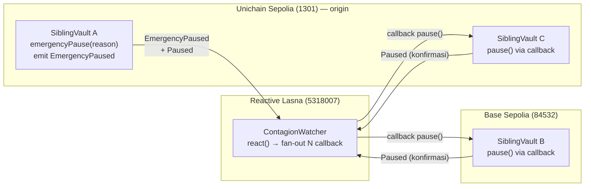
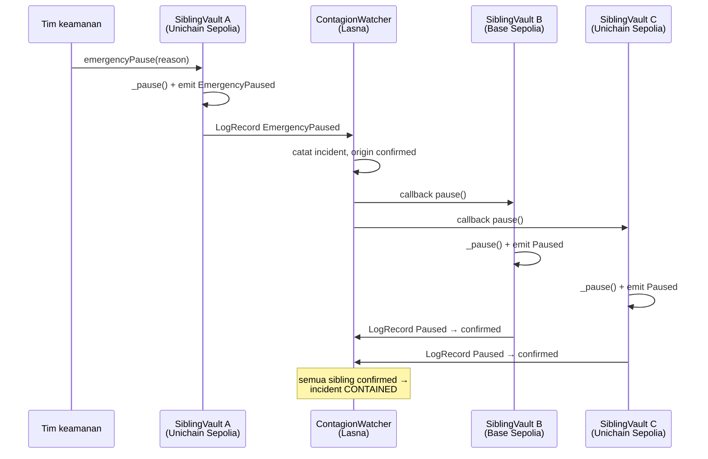

# Desain — ContagionStop: Pemutus Sirkuit Lintas-Chain (Every Second Counts)

**Track:** Every Second Counts (juara 1 $2.000, runner-up $250; dibayar REACT)
**Tenggat aman internal:** 5 Des 2026 siang WIB (resmi: 6 Des 2026 03:00 WIB)
**Status dokumen:** desain only. Belum ada akun dibuat, belum ada deploy, belum ada submit.
**Keputusan pivot:** 14 Nov 2026 20:24 WIB — pengguna memilih pivot dari WillVault ke ContagionStop.
Repo WillVault di `~/workspace/reactive-omni/repo/` DIARSIPKAN utuh — jangan diubah/dihapus, dan
jangan salin mentah dari sana. Dokumen ini meniru STRUKTUR `~/workspace/reactive-omni/design.md`
(WillVault) saja; isinya baru sepenuhnya.
**Sumber acuan:** `research/alternative-ideas.md` (Ide 1), `originality-research.md` (§4 A1, §5 skor
7,0), `verification-docs.md` (mekanika Reactive Omni), `ux-ui-research.md` §0 (paket UX/UI).
**Spesifikasi kontrak:** dokumen ini adalah pasangan dari spesifikasi yang dipakai worker kontrak
Foundry secara paralel — nama kontrak, fungsi, event, dan state di bawah ini WAJIB dipakai persis;
jangan ubah penamaan sepihak. Bila ada konflik antara dokumen ini dan spesifikasi di tugas,
spesifikasi tugas yang menang dan dokumen ini harus dikoreksi.

---

## 1. Ringkasan

### Nama: **ContagionStop — Pemutus Sirkuit Lintas-Chain**

Satu baris: **eksploitasi di satu chain harus membekukan deployment saudaranya dalam hitungan
detik, tanpa menunggu manusia bangun tidur.**

ContagionStop adalah pemutus sirkuit (circuit breaker) lintas-chain untuk protokol yang
di-deploy di banyak chain. Ketika tim keamanan mem-pause satu deployment — karena exploit
terdeteksi — kontrak reaktif di Lasna menangkap event `EmergencyPaused` itu dan, dalam satu
`react()`, meminta callback `pause()` ke SEMUA deployment saudara di chain lain. Dana tidak
bergerak: yang terkunci hanya fungsi `deposit`/`borrow`/`mint` di tiap deployment saudara.
Yang membuka kunci kembali hanyalah manusia (tim protokol, per deployment, manual) setelah
audit — tidak ada unpause otomatis, selamanya.

### Fakta event (terverifikasi)

| Item | Fakta |
|---|---|
| Kompetisi | Reactive Omni Buildathon (DoraHacks) |
| Track | Every Second Counts — juara 1 $2.000 + runner-up $250 (total hadiah event $5.500 REACT) |
| Tenggat submit | **6 Des 2026 03:00 WIB** (target aman internal: 5 Des siang WIB) |
| Penilaian juri | Innovation / User experience / Technical implementation |
| Ground rules | Repo publik open source; deploy di Lasna; origin/destination WAJIB Unichain Sepolia (1301) atau Base Sepolia (84532); wajib cantumkan tx hash + alamat kontrak di README; video demo wajib; kode orisinal |
| Lasna | Chain ID **5318007** · RPC `https://lasna-rpc.rnk.dev/` · Explorer `https://lasna.reactscan.net/` |
| System contract | `0x8888888888888888888888888888888888888888` (sama di mainnet & Lasna) |
| Callback proxy Base Sepolia | `0x476F44b11F5C942c58f4c8E3d0300E5710743585` |
| Callback proxy Unichain Sepolia | `0x775c9B990ADe401060B78D0e98684eEf8d2466C1` |
| Faucet lREACT (Base Sepolia) | `0x2afaFD298b23b62760711756088F75B7409f5967` — 1 ETH → 100 lREACT, maks 5 ETH/tx |
| Skor orisinalitas (riset 14 Nov 2026) | 7,0 (Kriteria 5) — Kriteria 2 (complex/brilian) 7, Kriteria 3 (berfungsi/demo) 9 |

---

## 2. Masalah nyata — dan kenapa detik penting

### Siapa yang rugi hari ini

Protokol DeFi yang serius tidak hidup di satu chain: lending, bridge, dan vault yang sama
di-deploy di Base, Unichain, dan belasan chain lain — kode yang sama, risiko yang sama.
Ketika celah ditemukan di satu deployment, penyerang tidak berhenti di situ: ia mengulangi
serangan yang sama ke deployment saudaranya, karena ia tahu tiap deployment dijeda manual
oleh multisig yang butuh jam untuk berkumpul — anggota tim tersebar di zona waktu berbeda,
butuh kuorum, butuh transaksi yang ditandatangani satu per satu.

Yang rugi: **semua pengguna deployment kedua dan ketiga yang dananya masih bisa diselamatkan**
bila jeda terjadi dalam hitungan detik, bukan jam. Polanya sudah terbukti di kerugian nyata:
exploit bridge Ronin ($625 jt) dan Wormhole ($326 jt) menunjukkan bahwa sekali celah ketahuan,
penularan lintas deployment adalah ancaman nyata, bukan hipotesis. Bedanya dengan bridge:
di sini yang menular bukan dana curian, melainkan serangannya sendiri — dan penawarnya bukan
kecepatan manusia, melainkan kecepatan kontrak.

### Kenapa ini "Every Second Counts" yang sebenarnya

- **Jendela serangan diukur dalam blok, bukan hari.** Penyerang otomatis mengulang exploit
  dalam hitungan menit setelah celah pertama dieksploitasi. Multisig yang butuh 2–6 jam
  untuk kuorum sudah kalah sebelum mulai.
- **Nilai seluruh ide ini adalah detik.** Tidak ada tokenomics, tidak ada yield, tidak ada
  gamifikasi — hanya satu angka yang dinilai juri track ini: berapa lama dari event pemicu
  sampai deployment terakhir membeku. Demo "pause → 2 chain membeku dalam satu loop"
  adalah pengukuran latensi yang paling mudah dilihat juri dan paling sulit ditiru oleh
  ide Set-It-and-Forget-It.
- **Bukan Every Second Counts yang lain:** bukan stop-loss (sudah jadi contoh resmi),
  bukan arbitrase (mainstream), bukan alert (tidak mengeksekusi apa-apa). Ini
  **enforcement**: kontrak yang bertindak, bukan yang memberi tahu.

### Kenapa bukan multisig + bot off-chain saja (jawaban yang akan ditanya juri)

Multisig + bot monitoring off-chain adalah status quo — dan status quo itu punya dua titik
gagal: bot harus tetap hidup (server mati = tidak ada yang menjeda), dan multisig harus
sempat berkumpul (manusia tidur = tidak ada yang menjeda). ContagionStop memindahkan kedua
pekerjaan itu ke dalam kontrak: pemicunya adalah event on-chain yang sudah terverifikasi
dari protokol itu sendiri, eksekusinya adalah callback Reactive yang tidak butuh server
siapa pun tetap hidup. Satu-satunya pekerjaan manusia yang tersisa — dan sengaja disisakan —
adalah keputusan untuk membuka kembali (unpause), karena keputusan itu memang butuh penilaian,
bukan kecepatan (lihat §5).

---

## 3. Arsitektur

### 3.1 Diagram





**Topologi demo (3 sibling, 2 chain):** origin A di Unichain Sepolia, sibling B di Base
Sepolia, sibling C kedua di Unichain Sepolia. Tiga vault membuktikan fan-out benar-benar
N callback lintas chain (bukan 1-ke-1); dua di antaranya di chain yang sama dengan origin
membuktikan fan-out tidak peduli chain tujuan sama atau beda. Minimum yang masih bermakna
adalah 2 sibling (1 origin + 1 tujuan), tetapi demo memakai 3 agar klaim "1 react() → N
callback" terlihat di Reactscan, bukan hanya diucapkan. Arsitektur mendukung N berapa pun —
`registeredSiblings` adalah daftar, bukan pasangan tetap.

### 3.2 Tabel kontrak

| Kontrak | Chain | Peran | Fungsi kunci |
|---|---|---|---|
| `SiblingVault.sol` | Unichain Sepolia + Base Sepolia (satu deploy per deployment) | Vault demo pausable; emitter pemicu + penerima callback | `deposit()`, `withdraw(uint256)`, `emergencyPause(bytes32)`, `pause(address)`, `unpause()`, `setWatcher(address)` |
| `ContagionWatcher.sol` | Lasna (5318007) | Otak reaktif: langganan + logika incident + fan-out callback | `react(LogRecord)`, `registerSibling(uint256,address)`, `pause()`, `resume()`, `coverDebt()` |
| `ContagionTopics.sol` | — (library konstanta, di-compile ke watcher) | Topic0 event, dihitung keccak programatis | `EMERGENCY_PAUSED_TOPIC0`, `PAUSED_TOPIC0` |

Library: `reactive-lib-omni` v0.1.0 (GitHub `Reactive-Network/reactive-lib-omni`, git submodule
Foundry, remapping `@reactive/`). Solidity `0.8.29`. OpenZeppelin `Pausable` + `Ownable`.
**Satu kontrak tidak bisa reactive + callback sekaligus** (keduanya inherit `AbstractPayer`
dengan `_SERVICE_PROVIDER` immutable yang berbeda → tidak compile) — jadi watcher dan
sibling terpisah, seperti pola resmi.

### 3.3 `SiblingVault.sol` — vault demo pausable (origin + destination)

Inherit: `AbstractCallback` (+ `Ownable` + `Pausable` dari OpenZeppelin).
Constructor: `(IPayable callbackProxy_, address watcher_)` — proxy sesuai chain deploy
(Base Sepolia `0x476F44b11F5C942c58f4c8E3d0300E5710743585`, Unichain Sepolia
`0x775c9B990ADe401060B78D0e98684eEf8d2466C1`); `watcher_` boleh `address(0)` saat deploy
dan di-set kemudian via `setWatcher` (lihat §3.6 soal urutan deploy).

State:
```solidity
address public watcher;   // slot MUTABLE — alamat ContagionWatcher di Lasna (lihat §3.6)
```

Fungsi pengguna (dipanggil langsung di chain vault berada):
- `deposit()` payable, `whenNotPaused` — terima ETH uji. Saat paused, deposit **revert**:
  ini adalah bukti demo bahwa deployment sudah membeku.
- `withdraw(uint256 amount)` onlyOwner — tarik ETH kembali ke owner. **Tanpa**
  `whenNotPaused`, sengaja: saat paused, owner tetap bisa menyelamatkan dana keluar.
  Pause mengunci dana MASUK dan fungsi berisiko, bukan dana yang sudah ada.
- `emergencyPause(bytes32 reason)` onlyOwner — **HARUS bisa dipanggil saat paused**
  (tanpa `whenNotPaused`). Perilaku: `if (!paused()) _pause();` lalu
  `emit EmergencyPaused(msg.sender, reason)`. Guard `paused()` itu wajib: OpenZeppelin
  `_pause()` revert bila sudah paused, dan tanpa guard ini pemanggilan ulang untuk
  retry (§4) akan mustahil. Fungsi ini sekaligus mem-pause origin itu sendiri —
  origin adalah deployment pertama yang dibekukan, oleh tangannya sendiri.
- `unpause()` onlyOwner, MANUAL saja (lihat §5). Tidak ada jalur callback ke sini.

Fungsi callback (hanya lewat proxy + hanya dari watcher terdaftar):
- `pause(address watcher_)` — guard ganda `onlyServiceProvider` (pemanggil = callback
  proxy chain itu) + `onlyCallbackSender(watcher)` (pengirim asli = watcher yang
  terdaftar; lihat §3.6 soal slot mutable). Perilaku **idempotent**: `if (!paused())
  _pause();` lalu return — bila sibling sudah paused, callback tidak revert dan tidak
  meng-emit `Paused` kedua. Idempotensi ini keputusan desain (bukan di spesifikasi
  tugas): fan-out yang tumpang tindih (mis. dua trip berurutan) tidak boleh menghasilkan
  `CallbackFailure` yang tetap ditagih, dan tidak boleh ada event `Paused` palsu kedua
  yang membingungkan indexer. **Payload callback: argumen pertama HARUS `address`**
  (proxy menimpa 160 bit pertama dengan alamat watcher; di payload isi `address(0)`
  sebagai placeholder) — lupa ini = cara paling umum callback rusak.
- Tidak ada fungsi callback lain. Sibling tidak pernah meng-unpause via callback.

Fungsi dana/operasional:
- `receive()` payable; `coverDebt()` publik (wrapper `_coverDebt()` — melunasi utang
  callback agar eksekusi tidak berhenti diam-diam, lihat §7(c)).
- `setWatcher(address)` onlyOwner — set/rotasi slot `watcher` mutable.

Event:
- `EmergencyPaused(address indexed protocol, bytes32 reason)` — `protocol` =
  alamat vault ini sendiri (`msg.sender` saat emit = vault; `protocol` diisi alamat
  vault, bukan alamat owner — watcher memverifikasi `topic1 == emitter`, lihat §3.5).
  `reason` = kode alasan 32 byte dari tim keamanan (mis. `keccak("EXPLOIT")` atau
  kode internal; bebas, tetapi HARUS konsisten antara panggilan dan catatan incident).
- `Paused(address account)` / `Unpaused(address account)` — standar OpenZeppelin
  `Pausable` (di-emit `_pause()`/`_unpause()`).

### 3.4 `ContagionTopics.sol` — konstanta topic0

Topic0 dihitung keccak programatis (14 Nov 2026, `Crypto.Hash.keccak` / pycryptodome —
BUKAN dari hafalan, sesuai pelajaran workspace: hash yang diketik dari ingatan pernah
salah total). Verifikasi ulang dengan `cast keccak` saat compile test pertama.

| Event | Signature (untuk keccak) | topic0 |
|---|---|---|
| `EmergencyPaused(address,bytes32)` | `EmergencyPaused(address,bytes32)` | `0xe1465c54ccfb9a5d53db40c1c727bf2f8b65f920d4927be2ba1456de56b4a42b` |
| `Paused(address)` | `Paused(address)` | `0x62e78cea01bee320cd4e420270b5ea74000d11b0c9f74754ebdbfc544b05a258` |
| `Unpaused(address)` (referensi; TIDAK di-subscribe) | `Unpaused(address)` | `0x5db9ee0a495bf2e6ff9c91a7834c1ba4fdd244a5e8aa4e537bd38aeae4b073aa` |

Catatan: indexed atau tidaknya parameter TIDAK mengubah topic0 (signature string yang
di-keccak tidak memuat kata `indexed`). `EmergencyPaused` punya 1 parameter indexed
(`protocol`) → log-nya LOG2 (`opCode == 2`); `Paused` TIDAK punya parameter indexed
(OpenZeppelin `Pausable`: `event Paused(address account)` tanpa `indexed`) → log-nya
LOG1 (`opCode == 1`), dengan `account` sebagai satu-satunya argumen non-indexed di
`data`. `react()` WAJIB cek `opCode` sebelum decode, karena posisi topic nol belum
tentu berarti topic tak ada.

### 3.5 `ContagionWatcher.sol` — Lasna (reactive contract)

Inherit: `AbstractReactive` (+ `Ownable` untuk `registerSibling`/`pause`/`resume`).
**Tidak ada `AbstractPausableReactive` di lib v0.1.0** (quirk dari WillVault) → `pause()` /
`resume()` lokal di watcher bila perlu (lihat bawah).

Constructor: `(Sibling[] memory siblings_)` payable — menerima daftar sibling
`(chainId, siblingAddress)` dan langsung subscribe, untuk tiap sibling, DUA event:
`EmergencyPaused` dan `Paused`, masing-masing `SYSTEM.subscribe(chainId, sibling,
topic0, REACTIVE_IGNORE, REACTIVE_IGNORE, REACTIVE_IGNORE)`. Filter langganan adalah
equality atas (chain, contract, topic0) — alamat kontrak emitter sudah memadai sebagai
allowlist; `topic1` dibiarkan `REACTIVE_IGNORE` dan diperiksa di dalam `react()`.

State:
```solidity
struct Sibling { uint256 chainId; address addr; }
Sibling[] public registeredSiblings;              // daftar sibling per chain

struct Incident {
    uint256 trippedAt;   // block.timestamp Lasna saat trip pertama dicatat
    bytes32 reason;      // reason dari EmergencyPaused pertama
    bool active;         // true = containment masih berjalan
}
mapping(address => Incident) public incidents;    // keyed by origin contract address

mapping(uint256 => mapping(address => bool)) public confirmedPaused;
// confirmedPaused[chainId][sibling] — true bila event Paused sibling itu diterima
// dalam ronde konfirmasi berjalan

bool public paused;      // pause lokal watcher (darurat, tanpa redeploy)
```

Fungsi owner:
- `registerSibling(uint256 chainId_, address sibling_)` onlyOwner — tambah sibling
  pasca-deploy (subscribe kedua event saat itu juga). Dipakai bila topologi demo
  berubah tanpa redeploy watcher.
- `pause()` / `resume()` onlyOwner (lokal, lihat quirk di atas) — jeda darurat:
  saat `paused == true`, `react()` langsung fall-through tanpa callback apa pun.
  Jujur dicatat: pause TIDAK menghentikan langganan dan TIDAK menghentikan tagihan
  `react()` per log masuk — yang dihemat hanya biaya callback. Unsubscribe penuh
  adalah satu-satunya cara berhenti ditagih, dan itu keputusan yang tidak bisa
  dibatalkan dari dalam `react()` tanpa kehilangan langganan.
- `coverDebt()` publik (wrapper `_coverDebt()`).

`react(LogRecord log_)` — `external onlySystem`, **tidak pernah revert sebagai filter**
(fall-through bila log tidak cocok; revert tetap ditagih penuh). Urutan dispatch:

1. **Watcher paused lokal?** → return (tanpa callback, tanpa state change).
2. **Emitter terdaftar?** `log_.contractAddress` harus ada di `registeredSiblings`
   dengan `chainId` yang cocok. Bila tidak → return. Ini allowlist emitter —
   pertahanan pertama terhadap false positive (§7a).
3. **`topic0 == EMERGENCY_PAUSED_TOPIC0`:** cek `opCode == 2` dan
   `topic1 == log_.contractAddress` (protocol yang di-emit harus sama dengan emitter;
   bila tidak cocok → return defensif). Decode `reason` dari `log_.data` (bytes32).
   Lalu protokol incident (§4):
   - Bila `incidents[origin].active == false` → **incident baru**: catat
     `Incident(block.timestamp, reason, true)`; **reset** `confirmedPaused` untuk
     SEMUA sibling terdaftar; tandai origin confirmed
     (`confirmedPaused[originChain][origin] = true` — origin sudah mem-pause
     dirinya sendiri lewat `emergencyPause`); minta callback `pause()` ke SEMUA
     sibling KECUALI origin.
   - Bila `incidents[origin].active == true` → **re-emit = sinyal retry**
     (lihat §4): JANGAN sentuh catatan incident (`trippedAt`/`reason` tetap dari
     trip pertama — `trippedAt` adalah jangkar pengukuran latensi); minta callback
     `pause()` HANYA ke sibling yang `confirmedPaused == false`.
4. **`topic0 == PAUSED_TOPIC0`:** cek `opCode == 1` (LOG1 — `Paused` OZ tanpa
   parameter indexed; lihat §3.4). Tandai
   `confirmedPaused[log_.chainId][log_.contractAddress] = true`. Lalu cek containment:
   bila SEMUA sibling terdaftar sudah confirmed, tandai setiap incident yang masih
   `active` menjadi `active = false` (CONTAINED). Penandaan ini idempotent — event
   `Paused` ganda dari sibling yang sama tidak mengubah apa-apa.
5. **Topic0 lain** → return (fall-through, tanpa revert, tanpa callback).

`_requestPauseCallback(chainId_, sibling_)` internal:
```solidity
bytes memory payload = abi.encodeWithSignature("pause(address)", address(0));
SYSTEM.requestCallbackV_1_0(ISystemContract.CallbackConfiguration_V_1_0({
    chainId: chainId_, recipient: sibling_, gasLimit: 200_000, payload: payload }));
```
Gas limit **200.000 per callback — NILAI TERVERIFIKASI, bukan proposal**
(riset pra-build 14 Nov 2026, `prebuild-blockers.md` #5/#7): minimum jaringan
100.000 gas PER callback (bukan total); overhead proxy terukur **130.000 gas**
(`_extraGas` 80.000 + `_maxChargeGas` 50.000, diukur live via `eth_call`/`cast call`
di kedua proxy); `pause()` sendiri ~45.000–60.000 gas di tujuan → 200.000
meneruskan ~70.000 gas ke target, cukup. **150.000 TIDAK cukup** (hanya ~20.000
gas diteruskan → `InsufficientGas`, fee tetap ditagih). Fan-out didukung eksplisit
di docs resmi: "send callbacks to one or more destination chains" dan "a single
reactive transaction can request several callbacks" (`getCallbacks` mengembalikan
array). Satu `react()` → N callback (fan-out) — masing-masing
`requestCallbackV_1_0` adalah satu permintaan independen; status tiap callback
bisa dibaca via `SYSTEM.getCallbacks(txHash)`. **Catatan terbuka:** batas MAKS
jumlah callback per `react()` BELUM TERVERIFIKASI di docs (hanya contoh
"several callbacks") — tidak menghalangi fan-out 2; bila desain berkembang ke
5+ chain, wajib dites dulu (lihat §9).

### 3.6 Quirks lib v0.1.0 + urutan deploy (pelajaran WillVault)

| Quirk | Solusi yang dipakai di sini |
|---|---|
| `AbstractCallback._CALLBACK_SENDER` immutable — tidak bisa diperbaiki pasca-deploy bila alamat watcher salah / belum ada saat sibling di-deploy | Sibling memakai slot **`watcher` mutable** + modifier **`onlyWatcher`** (bandingkan argumen pertama payload yang di-inject proxy dengan slot `watcher`); guard `pause()` = `onlyServiceProvider` + `onlyCallbackSender(watcher)` di mana `watcher` adalah slot mutable itu, BUKAN `_CALLBACK_SENDER` immutable. Rotasi via `setWatcher(address)` onlyOwner. Kontrak TIDAK BOLEH bergantung pada `_CALLBACK_SENDER` untuk apa pun. |
| Tidak ada `AbstractPausableReactive` di lib v0.1.0 | `pause()`/`resume()` lokal di watcher (`bool public paused` + `onlyOwner`), `react()` early-return saat paused. |
| Constructor yang memanggil subscribe bisa revert saat simulasi lokal `forge script` (perangkap pra-Omni) | Bila masih terjadi di Omni, deploy watcher pakai `cast send --create` agar constructor hanya jalan on-chain. Dicatat sebagai asumsi yang harus dibuktikan worker kontrak (§9). |
| Satu kontrak tidak bisa reactive + callback sekaligus | Watcher dan sibling terpisah total; watcher tidak pernah menerima callback, sibling tidak pernah `react()`. |

**Urutan deploy (alamat saling membutuhkan):**
1. Deploy `SiblingVault` A (Unichain Sepolia), B (Base Sepolia), C (Unichain Sepolia) —
   constructor bawa proxy chain masing-masing + `watcher = address(0)` placeholder.
2. Deploy `ContagionWatcher` (Lasna, payable) bawa daftar 3 sibling → constructor
   langsung subscribe 6 langganan (2 event × 3 sibling).
3. `setWatcher(watcherAddress)` di tiap sibling (onlyOwner) — kabel penyambung.
4. Danai keduanya (§7c): watcher dengan lREACT, tiap sibling dengan ETH chain-nya.
5. Verifikasi: `cast call` baca `watcher()` di tiap sibling + cek status `active` dan
   langganan di `https://lasna.reactscan.net/`.
6. Uji loop penuh di testnet SEBELUM rekam video (§6).

### 3.7 Alur langkah-demi-langkah (skenario demo)

1. **Setup.** Tiga `SiblingVault` ter-deploy dan terdanai; watcher terdaftar + aktif.
   Masing-masing vault menerima `deposit()` ETH uji — ketiganya `Active`.
2. **Pemicu.** Tim keamanan (owner vault A) memanggil
   `emergencyPause(reason)` di Unichain Sepolia. Vault A mem-pause dirinya sendiri
   dan meng-emit `EmergencyPaused(A, reason)`. Dana di A tidak bergerak.
3. **Reaksi.** Watcher menerima LogRecord di Lasna → `react()` mencatat incident
   (`trippedAt`, `reason`, `active = true`), menandai A confirmed, dan meminta
   **2 callback** `pause()`: ke B (Base Sepolia) dan ke C (Unichain Sepolia).
   Satu `react()` → 2 callback.
4. **Eksekusi.** Reactive Signer mengirim kedua callback lewat proxy masing-masing
   chain. `pause()` di B dan C: guard lolos → `_pause()` → emit `Paused`.
   `deposit()` di B dan C kini revert.
5. **Konfirmasi.** Watcher menerima LogRecord `Paused` dari B dan dari C →
   `confirmedPaused[84532][B] = true`, `confirmedPaused[1301][C] = true` →
   semua sibling confirmed → incident `active = false` (CONTAINED).
6. **Bukti.** Dashboard menampilkan: incident (origin A, reason, trippedAt),
   status per sibling (A/B/C: Paused), dan 4 tx hash loop (§6) — plus percobaan
   `deposit()` pasca-pause yang revert sebagai bukti pembekuan.
7. **Penutup (manual, di luar loop).** Setelah audit, owner tiap vault memanggil
   `unpause()` sendiri-sendiri — watcher tidak terlibat dan tidak mencatatnya
   (lihat §5 dan keterbatasan di §3.8).

### 3.8 State machine watcher + incident lifecycle

```
Watcher:  IDLE ──EmergencyPaused──▶ TRIPPED ──semua confirmed──▶ CONTAINED
              ▲                          │                           │
              │                          │ re-emit (retry)           │ trip baru
              │                          ▼                           ▼
              └────────────── (ronde baru) ◀────────────────── TRIPPED
              (pause lokal: TRIPPED/IDLE → PAUSED → resume → kembali)

Incident (per origin):
  NONE ──trip──▶ ACTIVE (trippedAt, reason tercatat; konfirmasi di-reset)
         │            │
         │            ├── Paused per sibling → confirmedPaused = true
         │            └── semua sibling confirmed → CONTAINED (active = false)
         └── re-emit saat ACTIVE → retry ke yang belum confirmed (catatan tak berubah)
```

**Keputusan desain yang mengikat (dibuat di dokumen ini, untuk worker kontrak):**
- `active` berarti "containment masih berjalan", BUKAN "sibling masih paused".
  Incident menjadi CONTAINED saat semua sibling terkonfirmasi paused — meski setelah
  itu owner meng-unpause manual satu per satu, watcher tidak melacaknya (ia tidak
  subscribe `Unpaused`; lihat keterbatasan di bawah).
- `trippedAt`/`reason` berasal dari trip PERTAMA dan tidak pernah ditimpa oleh
  re-emit retry — jangkar pengukuran latensi (§6) dan catatan kanonik penyebab.
- `confirmedPaused` adalah **satu ronde global** per `(chainId, sibling)`, bukan
  per incident — sesuai spesifikasi (`confirmedPaused[chainId][sibling]`). Trip baru
  dari origin mana pun me-reset ronde. Konsekuensi: dua origin yang trip hampir
  bersamaan diserialisasi oleh trip terakhir; sibling yang sudah paused (dan karena
  itu callback-nya early-return tanpa event `Paused` baru) bisa menahan status
  ronde di "partially confirmed" meski kenyataannya semua sibling sudah paused.
  Dampaknya terbatas: tidak ada loop retry otomatis (§4), jadi tidak ada biaya
  berjalan dan tidak ada aksi salah — hanya status yang tertahan sampai trip
  berikutnya. Perbaikan pasca-demo: `confirmedPaused` per incident
  (`confirmedPaused[origin][chainId][sibling]`) atau subscribe `Unpaused`.
- Watcher TIDAK subscribe `Unpaused` di v1 — sengaja. Unpause adalah urusan manusia
  per deployment; watcher tidak punya aksi apa pun atas informasi itu.

---

## 4. Fan-out + konfirmasi + retry — protokol lengkap

Ini adalah isi teknis ContagionStop. Kritik yang paling mungkin dari juri — "kontrak
tujuan cuma `pause()`, apa yang complex?" — dijawab di sini, bukan dengan memperumit
`pause()`, melainkan dengan menunjukkan bahwa yang sulit adalah **koordinasi N chain
yang tidak atomik, tidak sinkron, dan bisa gagal sebagian**.

### 4.1 Mengapa fan-out adalah masalah nyata

Event → `react()` → callback adalah 3+ transaksi terpisah di chain berbeda. Tidak ada
atomicity lintas chain: tidak ada rollback bila callback ke-2 gagal sementara callback
ke-1 sukses. Tanpa protokol konfirmasi + retry, hasil akhirnya adalah keadaan yang
paling berbahaya: **satu deployment terbuka sementara tim mengira semuanya sudah
membeku**. Protokol di bawah ini adalah jawaban atas keadaan itu — dan pola yang sama
dipakai demo resmi stop-loss Reactive (konfirmasi event + retry/cooldown), di sini
diterapkan ke fan-out multi-chain, bukan 1-ke-1.

### 4.2 Protokol (normatif)

| # | Aturan | Detail |
|---|---|---|
| P1 | **Satu trip, N callback** | Satu `react()` atas `EmergencyPaused` meminta callback `pause()` ke tiap sibling terdaftar KECUALI origin. N = jumlah sibling − 1 (demo: 2). |
| P2 | **Origin confirmed di tempat** | Origin menandai dirinya confirmed saat trip — ia sudah mem-pause dirinya sendiri lewat `emergencyPause`. Tidak menunggu event `Paused`-nya sendiri (yang juga akan datang dan bersifat idempotent). |
| P3 | **Konfirmasi lewat event, bukan asumsi** | Callback dianggap berhasil HANYA bila LogRecord `Paused` dari sibling itu diterima watcher. `requestCallbackV_1_0` yang sukses dikirim bukan bukti eksekusi — callback bisa gagal di tujuan (`CallbackFailure`) dan tetap ditagih. |
| P4 | **Retry = re-emit oleh origin** | Bila satu tujuan belum terkonfirmasi, operator/owner origin memanggil `emergencyPause(reason)` ULANG. Re-emit ini mungkin karena `emergencyPause` boleh dipanggil saat paused (§3.3). Watcher memperlakukannya sebagai retry (incident masih `active`): hanya fan-out ke tujuan yang `confirmedPaused == false`. Tidak ada CRON, tidak ada polling, tidak ada loop retry otomatis. |
| P5 | **Retry tidak menimpa catatan** | Re-emit tidak mengubah `trippedAt`/`reason` incident dan tidak me-reset konfirmasi yang sudah didapat. Yang sudah confirmed tidak pernah diminta callback ulang. |
| P6 | **Trip baru me-reset ronde** | Bila incident sebelumnya sudah CONTAINED (`active == false`) dan `EmergencyPaused` baru datang dari origin yang sama (atau origin lain), itu incident baru: catat ulang, reset SEMUA `confirmedPaused`, fan-out penuh ke semua non-origin. |
| P7 | **Idempotensi di kedua ujung** | Watcher: penandaan `confirmedPaused` dan transisi CONTAINED idempotent. Sibling: `pause()` idempotent (early-return bila sudah paused, tanpa revert, tanpa event ganda). Log `Paused` ganda tidak mengubah state. |
| P8 | **Tidak ada batas retry otomatis** | Karena retry dipicu manusia (re-emit), tidak ada `MAX_ATTEMPTS`/`RETRY_COOLDOWN` otomatis seperti WillVault. Batasnya adalah perhatian operator — dan setiap re-emit tercatat on-chain sebagai event, jadi audit trail-nya lengkap. |

### 4.3 Kenapa ini isi teknisnya (jawaban atas "cuma pause()")

1. **Fan-out N callback dari satu `react()`** — pola ini tidak ada di demo resmi mana pun
   sebagai pola utama (demo resmi umumnya 1 event → 1 callback; stop-loss 1 order →
   1 eksekusi). Gas `react()` dibatasi 900.000; tiap `requestCallbackV_1_0` menambah
   biaya; jumlah sibling yang didukung dibatasi oleh anggaran gas itu — batas yang
   harus diukur (§6), bukan diasumsikan.
2. **Konfirmasi per-tujuan yang tidak atomik** — watcher harus melacak matriks
   `confirmedPaused[chainId][sibling]` lintas chain dan lintas waktu, dengan event
   yang bisa datang dalam urutan apa pun (atau tidak datang sama sekali). Ini adalah
   state machine terdistribusi, bukan sekadar "kirim dan lupakan".
3. **Retry yang aman terhadap duplikasi** — membedakan "incident baru" dari "re-emit
   retry" hanya dari flag `active` + kunci origin adalah keputusan protokol yang
   salah sedikit saja berakibat fatal: reset yang salah → callback ganda ke sibling
   yang sudah paused (biaya terbuang + event membingungkan); retry yang salah
   dideteksi sebagai incident baru → `trippedAt` tertimpa → metrik latensi rusak.
4. **Fail-closed di setiap lapis** — kegagalan apa pun (callback gagal, event hilang,
   sibling sudah paused) berakhir di keadaan AMAN (paused) atau TERLIHAT (belum
   confirmed, menunggu re-emit operator) — tidak pernah di keadaan "dikira aman
   padahal terbuka". Itu adalah sifat yang harus dirancang; default-nya tidak ada.
5. **Biaya diam = nol.** Tanpa CRON dan tanpa polling, watcher tidak membayar apa-apa
   saat tidak ada incident — berbeda dari desain berbasis CRON yang menagih tiap tick.
   Untuk pemutus sirkuit yang (semoga) hampir tidak pernah trip, ini adalah sifat
   ekonomi yang benar: mahal hanya saat dibutuhkan.

### 4.4 Yang SENGAJA tidak ada (dan kenapa)

- **Tidak ada CRON / health-check berkala.** Tidak ada yang perlu dicek berkala:
  incident hanya lahir dari event. Menambah CRON hanya menambah tagihan tiap tick
  tanpa menambah keamanan.
- **Tidak ada auto-retry oleh watcher.** Retry otomatis butuh pemicu berkala (CRON)
  dan bisa mengulang callback ke sibling yang sebenarnya sudah paused tapi event
  `Paused`-nya telat — membakar fee tanpa guna. Retry manual via re-emit lebih murah,
  lebih bisa diaudit, dan operator selalu tahu persis kapan ia memintanya.
- **Tidak ada callback ke origin.** Origin sudah paused oleh tangannya sendiri;
  mengiriminya callback adalah pemborosan gas.
- **Tidak ada pengiriman dana lintas chain.** Tidak ada dana yang bergerak — callback
  hanya memerintahkan `pause()` lokal di chain tujuan, dari dana/fee yang sudah ada
  di sana.

---

## 5. Unpause MANUAL — alasan keamanan (eksplisit)

**Unpause HANYA bisa dilakukan manual oleh owner tiap `SiblingVault`, lewat
`unpause()` onlyOwner, per deployment, satu per satu. Tidak ada jalur callback ke
`unpause()`. Tidak ada timer auto-unpause. Tidak ada `resume()` otomatis di watcher
yang membuka kembali sibling. Ini bukan kekurangan yang belum sempat dibangun — ini
keputusan keamanan yang disengaja, dan melanggarnya akan menjadi lubang keamanan.**

Alasannya, satu per satu:

1. **Auto-unpause adalah lubang keamanan.** Bila ada jalur otomatis untuk membuka
   kembali — timer, callback, atau kondisi on-chain apa pun — maka penyerang yang
   berhasil memicu trip (atau yang mengeksploitasi celah yang sama) tinggal menunggu
   atau memicu kondisi itu untuk membuka kembali deployment yang baru saja dibekukan.
   Pemutus sirkuit yang membuka sendiri bukan pemutus sirkuit; itu pintu putar.
2. **Penyerang bisa trip lalu unpause sendiri.** Skenario konkret: penyerang
   menemukan cara memicu `EmergencyPaused` (mis. lewat celah di peran owner origin
   atau lewat social engineering operator) — lalu memakai jalur auto-unpause yang
   sama untuk membuka deployment saudara tepat saat exploit-nya siap. Satu mekanisme
   otomatis untuk kedua arah berarti satu kompromi membatalkan seluruh sistem.
3. **Membuka kembali butuh penilaian manusia, bukan kecepatan.** Menutup butuh detik
   (eksploitasi sedang berjalan). Membuka butuh audit: apakah celah sudah ditambal?
   Apakah dana di deployment itu masih utuh? Apakah penyerang masih punya posisi?
   Tidak satu pun pertanyaan itu bisa dijawab kontrak — dan jawaban yang salah
   biayanya adalah seluruh dana deployment itu. Kecepatan di arah ini bukan fitur;
   itu risiko.
4. **Asimetri ini adalah desainnya.** Tutup = otomatis, cepat, murah, fail-closed.
   Buka = manual, lambat, mahal (butuh manusia + audit), fail-closed juga (bila
   ragu, biarkan tetap paused — dana tidak hilang karena paused, hanya tidak bisa
   masuk). Pemutus sirkuit listrik di rumah bekerja persis seperti ini: ia jeglek
   sendiri saat korsleting, dan hanya manusia yang boleh menaikannya kembali setelah
   memeriksa.
5. **Per deployment, bukan global.** Owner tiap vault meng-unpause vault-nya sendiri
   setelah audit deployment itu. Tidak ada "unpause semua" — deployment yang masih
   dicurigai tetap beku sementara yang sudah bersih beroperasi kembali. Watcher
   tidak mencatat unpause (tidak subscribe `Unpaused`, §3.8) karena tidak ada aksi
   yang harus ia ambil atasnya.

**Yang harus tertulis di README dan video (jangan disembunyikan):** "Unpause is manual
by design. There is no automatic unpause path — anyone promising one is selling you
a backdoor."

---

## 6. Metrik latensi — apa yang diukur dan bagaimana

Juri track Every Second Counts menilai angka latensi loop penuh yang diukur sendiri
(blog resmi buildathon menekankan ini; tidak ada angka resmi event→callback yang
dipublikasikan docs). Semua angka di bawah ini **DIUKUR di testnet setelah deploy —
bukan dikarang**. Tabel di bagian ini adalah FORMAT yang akan diisi di README; kolom
nilai dibiarkan kosong/placeholder sampai ada angka asli.

### 6.1 Definisi pengukuran

| # | Metrik | Definisi (awal → akhir) | Cara ukur |
|---|---|---|---|
| M1 | **Latensi loop penuh** (metrik utama) | Block timestamp tx `emergencyPause` di Unichain Sepolia (blok yang memuat event `EmergencyPaused`) → block timestamp tx callback `pause()` TERAKHIR yang sukses (blok yang memuat event `Paused` di sibling terakhir) | Timestamp blok dari explorer kedua chain (Unichain Sepolia + Base Sepolia); pakai **timestamp**, bukan jumlah blok (Base Sepolia ~200 ms/blok, Unichain ~1 dtk/blok — hitungan blok menyesatkan) |
| M2 | Latensi event → `react()` | Block timestamp tx `emergencyPause` (Unichain) → block timestamp tx `react()` (Lasna, Reactscan) | Reactscan + explorer Unichain |
| M3 | Latensi `react()` → callback | Block timestamp tx `react()` (Lasna) → block timestamp tx callback `pause()` per tujuan | Reactscan + explorer tiap chain tujuan |
| M4 | Latensi per tujuan | M1 dihitung per sibling (B dan C terpisah) — menunjukkan fan-out tidak menghukum tujuan kedua | Sama seperti M1, per sibling |
| M5 | Gas `react()` (fan-out 2 callback) | `gasUsed` tx reactive di Reactscan | Harus < 900.000 (batas jaringan) |
| M6 | Gas callback `pause()` | `gasUsed` tx callback di explorer tujuan | Harus < `gasLimit` yang diminta (200.000, terverifikasi — lihat §7e) |
| M7 | Biaya loop penuh | lREACT terpakai watcher + ETH terpakai tiap sibling (dari `debt`/`reserves` sebelum–sesudah, via `cast call`) | Dilaporkan apa adanya, per loop |
| M8 | Waktu sampai CONTAINED | `trippedAt` (catatan watcher) → timestamp saat `confirmedPaused` terakhir ter-set | Dari event `Paused` terakhir + state watcher (`cast call incidents`) |
| M9 | Konfirmasi | Jumlah sibling confirmed / total, + tx hash tiap `Paused` | Explorer + Reactscan |

**Ekspektasi (bukan janji, bukan angka yang dikarang):** loop penuh diharapkan dalam
hitungan puluhan detik — komponennya adalah finality origin (~1 blok Unichain) +
relay Lasna (~1 dtk/blok + finality instan) + eksekusi callback di tujuan. Bila hasil
ukur jauh dari itu, angka aslinya yang dilaporkan + penyebabnya diselidiki — jangan
pernah menyesuaikan angka agar terlihat bagus.

### 6.2 Format tabel yang akan diisi di README setelah deploy

| # | Pengukuran | Tx/blok awal | Tx/blok akhir | Nilai |
|---|---|---|---|---|
| M1 | Loop penuh (trip → sibling terakhir paused) | `0x…` (emergencyPause, Unichain) | `0x…` (Paused terakhir) | … detik |
| M2 | Event → `react()` | `0x…` | `0x…` (react, Lasna) | … detik |
| M3 | `react()` → callback (Base Sepolia) | `0x…` (react) | `0x…` (pause B) | … detik |
| M4 | `react()` → callback (Unichain, sibling C) | `0x…` (react) | `0x…` (pause C) | … detik |
| M5 | Gas `react()` fan-out 2 | — | `0x…` (react) | … gas (< 900.000) |
| M6 | Gas callback `pause()` | — | `0x…` | … gas (< 200.000) |
| M7 | Biaya loop penuh | — | — | … lREACT + … ETH (Base) + … ETH (Unichain) |
| M8 | Waktu sampai CONTAINED | `trippedAt` = … | konfirmasi terakhir = … | … detik |
| M9 | Konfirmasi | — | — | … / 2 sibling confirmed |

**Bukti loop lengkap untuk submission (wajib, seperti pola OmniStop): 4 tx hash** —
(1) event `emergencyPause` (Unichain Sepolia), (2) `react()` (Lasna),
(3) callback `pause()` B (Base Sepolia), (4) callback `pause()` C (Unichain
Sepolia). Event `Paused` konfirmasi termuat di tx (3) dan (4) — tidak dihitung
sebagai tx terpisah. Keempatnya dicantumkan di README + form DoraHacks + layar
akhir video. Ditambah satu percobaan `deposit()` pasca-pause yang revert (tx
hash-nya juga dicantumkan sebagai bukti pembekuan). Video direkam dengan
Xvfb + ffmpeg (uji asap 14 Nov 2026 lolos: MP4 valid 2,0 dtk 1920x1080) — OBS
headless TIDAK layak di VM ini, jangan pakai. Demo ContagionStop lebih mudah
direkam daripada WillVault: pemicu instan, tanpa jeda tunggu 5 menit; tampilkan
2 explorer berdampingan + timer latensi (latensi = isi teknis utama track ini).

### 6.3 Uji yang harus lolos sebelum video direkam

1. Loop penuh 1× end-to-end: trip → 2 callback sukses → CONTAINED → `deposit()`
   revert di B dan C.
2. Retry: buat satu callback gagal (mis. sibling B didanai TIDAK cukup sehingga
   callback revert/stall, lalu danai + re-emit dari origin) → pastikan retry hanya
   fan-out ke B, bukan ke C yang sudah confirmed; pastikan `trippedAt` tidak berubah.
3. Fall-through: kirim log dari emitter tak terdaftar (mis. `EmergencyPaused` dari
   kontrak acak) → `react()` tidak revert dan tidak meminta callback apa pun.
4. Idempotensi: panggil `pause()` callback dua kali ke sibling yang sudah paused →
   tidak revert, tidak ada event `Paused` kedua.
5. Unpause manual: owner B `unpause()` → `deposit()` bisa lagi; watcher tidak
   bereaksi (tidak ada callback, tidak ada state berubah di watcher).

### 6.4 Patokan latensi pesaing + rencana pengukuran konkret (WAJIB)

Track Every Second Counts dinilai dari kecepatan — dan pesaing sudah memamerkan
angka terukur, bukan janji. Patokan dari cek live browser halaman build
14 Nov 2026 20:29–20:30 WIB:

| Build | Klaim latensi terukur | Catatan |
|---|---|---|
| Tripwire (luongs3) | **Median 1,4 dtk** (7 blok Base) setelah harga melewati stop | 17/18 ronde live terisi; 1 gagal karena callback tidak pernah tiba (lihat §7b) |
| SnapGuard (Folorunso800) | **~2 dtk**, latensi loop dicatat on-chain | Stop-loss/take-profit, paper trading vault |
| OmniStop (samimi) | **Loop penuh 2.000 ms** | Sinyal stop-loss MVP; "executeSwap records the signal only. No funds move." |

**Demo ContagionStop WAJIB menampilkan latensi loop-nya sendiri yang terukur
on-chain** — ini yang dibandingkan juri dengan angka di atas. Rencana pengukuran
konkret (tiga stempel waktu, semuanya dari explorer — bukan dari log aplikasi):

| Stempel | Sumber | Cara ambil |
|---|---|---|
| **T0** — block timestamp tx `emergencyPause` (origin, Unichain Sepolia) | Blok yang memuat event `EmergencyPaused` | Unichain explorer (sepolia.uniscan.xyz) — `timestamp` blok tx (1) |
| **T1** — block timestamp tx `react()` (Lasna) | Blok tx reactive di Reactscan | `lasna.reactscan.net` — `timestamp` blok tx (2) |
| **T2a / T2b** — block timestamp receipt callback `pause()` per chain | Blok tx callback di tiap explorer tujuan | BaseScan Sepolia (tx 3) + Unichain explorer (tx 4) — `timestamp` blok masing-masing |

**Rumus yang dilaporkan:** latensi per tujuan = T2a − T0 (Base) dan T2b − T0
(Unichain); rincian T1 − T0 (event → react) dan T2 − T1 (react → callback)
ditampilkan terpisah agar juri melihat di kaki mana waktu habis; **latensi loop
penuh = max(T2a, T2b) − T0** (tujuan terlambat — angka jujur, bukan yang tercepat).
Ketiga stempel + ketiga selisih tampil di README (tabel §6.2) DAN di dashboard
(§10.1, angka latensi) DAN disebut di video. Semua memakai **block.timestamp**,
bukan jumlah blok (Base Sepolia ~200 ms/blok, Unichain ~1 dtk/blok — hitungan
blok menyesatkan).

**Aturan kejujuran latensi (mengikat):** bila latensi kita setara atau lebih cepat
dari patokan 1,4–2,0 dtk, tonjolkan angkanya di hook video dan di README. Bila
lebih lambat, JANGAN sembunyikan — tampilkan angkanya dengan jujur dan jelaskan
kenapa: loop kita fan-out ke **2 chain** (2 callback + 2 konfirmasi lintas chain),
sementara patokan pesaing adalah loop **1 chain** (1 callback); per-tujuan, angka
kita sebanding — dan yang dibandingkan secara adil adalah T2 per tujuan, bukan
hanya headline loop penuh. Angka yang lebih lambat dengan penjelasan yang benar
lebih berharga di mata juri daripada angka yang hilang.

---

## 7. Risiko + mitigasi

### (a) False positive = DoS terhadap protokol sendiri — risiko terbesar

**Fakta:** bila emitter yang di-subscribe bisa di-trigger penyerang, penyerang bisa
membekukan deployment saudara sesuka hati — ContagionStop berubah dari pelindung
menjadi senjata. Ini adalah risiko terbesar desain ini, dan satu-satunya yang bisa
membuat juri menolak konsepnya bila tidak dijawab.

**Mitigasi berlapis (tidak mengandalkan satu hal):**
1. **Allowlist emitter** — watcher hanya bereaksi atas log dari alamat sibling yang
   terdaftar di `registeredSiblings` (cek `chainId` + `contractAddress` di `react()`,
   §3.5 langkah 2). Log dari kontrak lain — termasuk kontrak penyerang yang meng-emit
   event dengan nama sama — fall-through tanpa aksi.
2. **Pemicu hanya dari peran owner origin** — `emergencyPause()` adalah `onlyOwner`
   (spesifikasi). Di produksi, owner HARUS multisig tim keamanan atau peran
   `PAUSER` yang dipegang multisig — demo memakai EOA owner hanya untuk testnet.
   Yang bisa memicu trip hanyalah pemegang kunci yang memang berwenang mem-pause
   deployment itu secara manual; ContagionStop tidak menambah SIAPA PUN yang bisa
   mem-pause, ia hanya mempercepat penyebaran pause yang sudah sah.
3. **Cooldown struktural** — incident baru dari satu origin hanya bisa dicatat
   setelah incident sebelumnya CONTAINED (`active == false`); re-emit saat incident
   masih aktif hanya retry ke tujuan yang belum confirmed (§4, P4–P6). Tidak ada
   jalur bagi satu trip untuk me-reset konfirmasi yang sudah didapat, dan tidak ada
   loop otomatis yang bisa dipicu berulang tanpa operator.
4. **Unpause manual sebagai pemutus akhir** (§5) — kalaupun trip palsu terjadi,
   kerusakannya terbatas pada penghentian deposit sementara sampai owner tiap
   deployment meng-unpause setelah memeriksa. Dana tidak hilang karena paused.

**Kejujuran yang wajib dijaga:** mitigasi di atas TIDAK melindungi dari owner yang
dikompromikan (kunci multisig bocor = penyerang bisa mem-pause manual juga, dengan
atau tanpa ContagionStop). Yang dilindungi adalah: penyerang TANPA kunci owner tidak
bisa memicu apa pun. Bila juri bertanya "bagaimana bila owner dikompromikan?",
jawabannya adalah itu — bukan klaim bahwa sistem kebal terhadap kompromi owner.

### (b) Fan-out sebagian gagal — satu deployment tetap terbuka

**Fakta:** callback ke-2 bisa gagal (gas/dana habis di sisi tujuan, proxy menolak,
sibling revert) sementara callback ke-1 sukses. Tanpa penanganan, hasilnya adalah
keadaan paling berbahaya: tim mengira semuanya membeku, padahal satu deployment
masih menerima deposit — dan penyerang akan menemukannya.

**Mitigasi:** protokol konfirmasi + retry (§4) — keberhasilan HANYA diakui lewat
event `Paused` dari sibling itu (P3); yang belum confirmed terlihat di state watcher
(`confirmedPaused`) dan di dashboard (§10) sebagai "1/2 confirmed", bukan disembunyikan;
retry via re-emit operator hanya fan-out ke yang belum confirmed (P4–P5). Tidak ada
keadaan "dikira aman padahal terbuka" yang tidak terlihat: status containment selalu
terbaca on-chain sebelum ada yang mengklaim selesai.

**Pelajaran dari pesaing — Tripwire (bukan ejekan, bukti bahwa risiko ini nyata):**
dalam 18 ronde live Tripwire, **1 callback tidak pernah tiba** dan penulisnya masih
menyelidiki penyebabnya (cek halaman build 14 Nov 2026 20:29–20:30 WIB). Tanpa
protokol konfirmasi + retry, kegagalan seperti itu tidak terlihat — sistem diam-diam
mengira order tereksekusi. Di ContagionStop, kegagalan yang sama persis (callback
`pause()` yang tidak tiba) AKAN terlihat: sibling itu tetap `confirmedPaused ==
false`, dashboard menampilkan "1/2 confirmed", dan operator me-re-emit untuk
retry hanya ke tujuan itu. Inilah alasan §4 ada — bukan teori, melainkan jawaban
atas kegagalan yang sudah terjadi di depan mata pada build lain di event yang sama.

### (c) Utang diam-diam (silent stall) — kontrak berhenti tanpa error

**Fakta (terukur, riset pra-build 14 Nov 2026):** utang > 0 di salah satu sisi
membuat eksekusi BERHENTI total tanpa error keras — system contract tidak memanggil
`react()`, proxy tidak mengirim callback; status hanya terlihat sebagai `inactive`
di Reactscan. Revert tetap ditagih penuh. Lasna baseFee **100 gwei FLAT** (terukur
live via RPC, 5 blok) + koefisien 1,0 + surcharge 100.000 gas.

**Biaya terukur (bukan tebakan) — diperbarui 14 Nov 2026 21:33 WIB dengan angka
pengukuran lokal sprint implementasi (`GasReport.t.sol`, mock system =
lower bound; wajib ukur ulang on-chain, M5/M6):**

| Item | Biaya |
|---|---|
| `react()` fall-through (log tak cocok / tanpa aksi) | ±0,014 lREACT (ukur: 30.472 gas) |
| `react()` trip baru, fan-out 2 callback | ≈0,061 lREACT (ukur: 511.247 gas) |
| `react()` retry, fan-out 1 callback | ≈0,026 lREACT (ukur: 158.071 gas) |
| Deploy watcher | ≈0,28 lREACT (ukur: 2.792.775 gas @100 gwei) |
| Satu loop penuh (trip → fan-out → konfirmasi) | ≈0,10–0,11 lREACT (ukur; bukan 0,30–0,35 — angka lama berbasis asumsi tick CRON WillVault) |
| Callback `pause()` di Base Sepolia | ≈0,000003 ETH (ukur: 31.485 gas di tujuan) |

**Koreksi eksplisit terhadap nominal demo resmi: 0,1 lREACT HANYA ≈7 tick —
TIDAK CUKUP untuk satu loop.** Jangan pernah mendanai watcher dengan 0,1 lREACT.
Dana watcher yang dipakai: **0,5 lREACT** (dipertahankan — menutup ~4–5 loop
penuh + retry dengan margin, bukan ~1 loop seperti perkiraan lama; top-up dari
stok 10 lREACT, lihat §11).

**Mitigasi:**
1. Danai berlebih sejak awal (watcher 0,5 lREACT; tiap sibling 0,02 ETH reserves
   untuk fee callback) dan catat angka pastinya di README.
2. `coverDebt()` publik di watcher dan di tiap sibling — siapa pun bisa melunasi
   utang agar eksekusi jalan lagi.
3. Runbook monitoring: SEBELUM demo, cek `debt`/`reserves` via `cast call` di
   ketiga sisi + status di Reactscan; uji skenario "dana menipis → `inactive` →
   `coverDebt()` → `active`" di testnet dan jadikan bukti di README bahwa tim
   memahami perilaku ini.
4. Desain hemat: tanpa CRON dan tanpa polling, watcher tidak membayar apa-apa saat
   tidak ada incident — biaya hanya muncul saat loop benar-benar berjalan.

### (d) Reorg origin — KEPUTUSAN: fail-closed, TANPA verifikasi ulang di callback

**Fakta:** sequencer Reactive menganggap event yang sudah diamati di origin chain
sebagai kanonik **meskipun chain origin itu kemudian reorg** — callback bisa terpicu
oleh transaksi yang akhirnya hilang di origin. Risiko ini di luar kendali developer
(blog resmi Reactive soal finality).

**Keputusan desain (dibuat di dokumen ini, mengikat): sibling TIDAK memverifikasi
ulang incident di callback `pause()`.** Alasannya:
1. **Sibling tidak bisa memverifikasi apa-apa.** Ia tidak bisa membaca state Lasna
   dan tidak bisa membaca state origin — satu-satunya fakta yang bisa ia periksa
   adalah pengirim callback (watcher, yang sudah diautentikasi proxy) dan status
   paused-nya sendiri. "Cek incident masih aktif?" bukan sesuatu yang bisa dijawab
   on-chain di chain tujuan; memaksakannya berarti menambah oracle — persis hal
   yang desain ini tolak (§8).
2. **Arah kegagalan yang benar untuk pemutus sirkuit adalah fail-closed.**
   Bila trip ternyata hasil reorg, akibatnya adalah sibling ter-pause secara
   keliru — kerugiannya terbatas pada deposit yang tertunda sampai owner meng-unpause
   manual. Bila sebaliknya kita menahan pause demi verifikasi, akibatnya adalah
   deployment tetap terbuka saat exploit nyata sedang berjalan — kerugiannya adalah
   seluruh dana deployment. Untuk circuit breaker, false positive < false negative.
   Ini kebalikan dari WillVault (di sana keputusan akhir dicek ulang di vault,
   karena pelepasan dana tidak bisa dibatalkan) — dan perbedaan itu disengaja,
   karena konsekuensi keduanya berlawanan.
3. **Trip palsu akibat reorg tetap butuh tx owner yang nyata.** `emergencyPause`
   hanya bisa dipanggil owner origin; reorg tidak menciptakan tanda tangan owner.
   Yang bisa hilang karena reorg hanyalah tx-nya — bukan kewenangannya.
4. **Mitigasi sisa:** pakai origin chain yang finality-nya kuat (Unichain Sepolia
   ~1 dtk/blok, Base Sepolia ~200 ms/blok — keduanya L2 finality cepat; reorg dalam
   yang menghapus tx terkonfirmasi praktis tidak terjadi di testnet ini); dan
   `trippedAt` memakai `block.timestamp`, bukan `block.number` (lihat §11).

### (e) Gas callback / InsufficientGas

**Fakta (terverifikasi, riset pra-build + pengukuran lokal 14 Nov 2026):** gas callback minimum jaringan 100.000
PER callback (bukan total); overhead proxy terukur 130.000 gas (`_extraGas` 80.000 +
`_maxChargeGas` 50.000, diukur live di kedua proxy); `pause()` ukur 31.485 gas
di tujuan (bukan ~45.000–60.000 seperti perkiraan awal). **Gas limit yang dipakai: 200.000 per callback** — meneruskan ~70.000
gas ke target, cukup. **150.000 TIDAK cukup** (hanya ~20.000 gas diteruskan →
`InsufficientGas`, dan fee tetap ditagih penuh). Gas `react()` dibatasi jaringan
900.000; `react()` trip baru fan-out 2 ukur 511.247 gas (maks 549.333 versi
forge) — jauh lebih besar dari "puluhan ribu gas" di draf awal, tapi masih di
bawah cap dengan headroom ~350 ribu. **Fan-out JANGAN diperluas melewati
3 sibling tanpa ukur ulang.** Angka on-chain wajib diukur ulang saat deploy
(M5).

**Mitigasi:** tetapkan 200.000 sejak awal (bukan angka yang ditebak lalu diperbaiki
saat demo gagal); ukur gas aktual `pause()` via `forge test --gas-report` + 1
callback nyata di testnet sebelum kunci angka final; danai reserves tiap sibling
0,02 ETH (margin >100× atas biaya callback ≈0,000003 ETH); bila `getCallbacks`
menunjukkan `InsufficientGas`, naikkan `gasLimit` dan ulangi — jangan ulangi
dengan angka yang sama.

### Risiko lain (dicatat, bukan 5 terbesar)

| Risiko | Status / mitigasi |
|---|---|
| Isi Tripwire (pesaing paling mirip) | ✅ TERVERIFIKASI AMAN 20:29–20:30 WIB — stop-loss/take-profit, bukan circuit breaker (§8(5), §9.3 O1) |
| Batas maks callback per `react()` belum terverifikasi | Tidak menghalangi fan-out 2; wajib dites bila desain berkembang ke 5+ chain (§9) |
| Form submit DoraHacks one-shot | Jangan submit draft percobaan; siapkan jawaban + sign-off pengguna dulu (§11, bukan Fase 1) |
| Aturan "dibangun selama event" | ContagionStop dibangun dari nol sekarang — bersih; bila repo dibuat, commit bertahap, jangan satu commit raksasa di akhir (§11) |
| RPC publik flaky / rate-limit (403 intermiten, riwayat rate-limit batch call) | 3 RPC per chain + retry; skrip deploy/verifikasi WAJIB `cast`/`curl`, bukan `urllib` Python (403) — lihat §11 |
| `foundry.toml` tanpa `evm_version` (Foundry 1.9.0 default `prague` untuk test, solc 0.8.29 default Cancun) | Pin `evm_version = "cancun"` eksplisit sebelum deploy (§11) |
| Faucet Chainlink cooldown tidak tercantum; angka faucet sekunder sebagian belum terverifikasi | Jangan andalkan sebelum terverifikasi; klaim sejak hari pertama build; JANGAN klaim apa pun dulu — deploy masih ditahan (§11) |

---

## 8. Pembeda WAJIB vs 4 pihak

Verdict: ContagionStop **AMAN** (naik dari "BUTUH PEMBEDA" setelah cek live browser
halaman build 14 Nov 2026 20:29–20:30 WIB — lihat §8(5) dan §9.3 O1–O2). Pembeda
di bawah ini tetap wajib tertulis eksplisit di README dan submission, bukan hanya
di desain ini — "aman" berarti tidak ada tabrakan konsep, bukan berarti pembeda
tidak perlu ditulis.

### (1) vs Pursestrings — otomatis vs tombol STOP manual

Pursestrings adalah tombol STOP manual: manusia harus menyadari serangan, membuka
dashboard, dan menekan tombol — lalu menunggu multisig atau operator mengeksekusi
di tiap chain. ContagionStop menghapus manusia dari jalur eksekusi sepenuhnya:
dari event `EmergencyPaused` sampai `pause()` di chain terakhir, tidak ada satu pun
transaksi yang ditandatangani manusia. **Bukti yang bisa dicek juri:** 4 tx hash loop
(§6.2) — di antara tx (1) `emergencyPause` dan tx (3)/(4) callback `pause()`,
tidak ada tx manusia apa pun; yang ada hanya tx `react()` Lasna yang dieksekusi
validator Reactive. Pursestrings menjawab "bagaimana manusia menghentikan serangan
lebih cepat"; ContagionStop menjawab "bagaimana serangan berhenti bahkan bila tidak
ada manusia yang terjaga".

### (2) vs ReactiveVaultGuard — enforcement vs deteksi saja

ReactiveVaultGuard adalah deteksi: ia mengawasi dan memberi tahu bahwa sesuatu yang
mencurigakan terjadi — tetapi setelah peringatan itu, tetap dibutuhkan seseorang
(atau sesuatu yang lain) untuk bertindak. ContagionStop adalah enforcement: callback-nya
benar-benar mengeksekusi `pause()` on-chain di tiap deployment saudara, dan
`deposit()` setelahnya revert. **Bukti yang bisa dicek juri:** percobaan `deposit()`
pasca-pause yang revert (tx hash dicantumkan, §6.2) — itu adalah bukti eksekusi,
bukan bukti peringatan. Deteksi tanpa enforcement adalah alarm kebakaran tanpa
sprinkler; ContagionStop adalah sprinklernya.

### (3) vs SentinelBridge / Aegis AI (Chainlink CRE + AI) — tanpa keeper/oracle/AI, deterministik

SentinelBridge dan Aegis AI adalah pendahulu yang jujur dan harus diakui di README:
keduanya melakukan auto-`pause()`/`emergencyPause()` lintas chain — tetapi lewat
Chainlink CRE (jaringan keeper/oracle off-chain) plus AI (LLaMA / sinyal X/Twitter).
ContagionStop melakukan hal yang sama tanpa satu pun dari ketiganya: pemicunya adalah
event on-chain dari protokol itu sendiri, logikanya Solidity murni di Lasna, dan
tidak ada model, oracle, atau jaringan keeper yang harus dipercaya atau dibayar
langganan (LINK). **Kenapa tidak pakai CRE? — dijawab di depan, bukan disembunyikan:**
CRE adalah alat yang tepat bila pemicunya membutuhkan data off-chain (sinyal sosial
seperti Aegis AI, atau harga dari luar chain). Di sini pemicunya SUDAH on-chain —
menambah CRE hanya menambah asumsi kepercayaan (DON CRE + model AI yang bisa
dibodohi), biaya langganan, dan latensi, untuk nol manfaat. Yang lebih sederhana
dan deterministik menang bila masalahnya memang on-chain. **Bukti yang bisa dicek
juri:** tidak ada satu pun dependensi off-chain di repo (tidak ada keeper, bot,
oracle, atau API key); seluruh loop bisa direplay dari 4 tx hash + state kontrak.

### (4) vs circuit breaker umum — versi Reactive-native pertama

Circuit breaker otomatis sebagai konsep sudah lama ada: kontrak `Pausable`
OpenZeppelin, pola BreakerBox, dan pemutus sirkuit di protokol besar semuanya
mem-pause saat kondisi terpenuhi. Yang belum ada adalah versi Reactive-native-nya:
tidak ditemukan satu pun implementasi, demo, atau contoh resmi Reactive yang
memakai event → Lasna → callback fan-out sebagai pemutus sirkuit lintas-chain
(pencarian "Reactive Network cross-chain circuit breaker example", 14 Nov 2026,
tidak mengembalikan satu pun contoh/demo Reactive soal circuit breaker).
ContagionStop mengklaim "pertama" HANYA dalam arti sempit dan jujur ini — **bukan**
"circuit breaker pertama" (itu klaim yang salah) — melainkan "pemutus sirkuit
pertama yang dieksekusi Reactive, tanpa keeper, tanpa oracle, tanpa AI". Klaim
yang lebih luas dari itu dilarang di README dan video. **TIDAK ADA circuit breaker
/ auto-pause lintas chain di antara 23 build** (terverifikasi 14 Nov 2026
20:29–20:30 WIB, halaman build dibaca lengkap — lihat §8(5)): klaim "pertama"
untuk kategori ini aman dipakai dengan kualifikasi **"di event ini"**, bukan
klaim absolut dunia.

### (5) vs tiga build ESC terdekat — Tripwire / SnapGuard / OmniStop (terverifikasi 20:29–20:30 WIB)

Ketiganya adalah **stop-loss / take-profit berbasis harga, BUKAN circuit breaker**:
tidak satu pun menyebut "pause", "circuit breaker", "halt", atau "freeze", dan
tidak satu pun menjeda/membekukan kontrak atau vault. Perbedaan kategorinya
total — yang satu menjual saat harga menyentuh ambang, yang satu membekukan saat
exploit terdeteksi — tetapi ketiganya adalah patokan latensi yang harus dihadapi
(§6.4) dan bukti bahwa tidak ada yang mengerjakan kategori ini.

| Build | Apa yang dilakukan | Latensi terukur | Bedanya dengan ContagionStop |
|---|---|---|---|
| **Tripwire** (luongs3) | Keeperless stop-loss/take-profit: harga melewati stop → callback eksekusi order | Median **1,4 dtk** (7 blok Base); 17/18 ronde live terisi, **1 gagal karena callback tidak pernah tiba** (penulis masih menyelidiki) | Pemicu = harga (oracle/DEX), aksi = jual. ContagionStop: pemicu = event keamanan protokol, aksi = `pause()` lintas chain. Kontrak: TripwireVault Base Sepolia `0x9398F94AF0019dd97216eFF93B5f5CCE6518b70f`, TripwireReactive Lasna `0xC71aF4493646b60d920D9093622CC16b98B67425` |
| **SnapGuard** (Folorunso800) | Stop-loss/take-profit ~2 dtk, paper trading vault, latensi loop dicatat on-chain | **~2 dtk** | Pemicu = harga, aksi = eksekusi order (paper trading). Tidak ada pause, tidak ada pembekuan vault |
| **OmniStop** (samimi) | Sinyal stop-loss MVP, loop penuh 2.000 ms | **2.000 ms** | Penulisnya jujur menulis: "executeSwap records the signal only. No funds move." — tidak ada dana bergerak, apalagi pause. ContagionStop sebaliknya: callback-nya benar-benar mengeksekusi `pause()` dan `deposit()` setelahnya revert |

**Kesimpulan pembanding:** di antara 23 build, ContagionStop adalah satu-satunya
yang aksi callback-nya adalah pembekuan (`pause()`), bukan eksekusi order. Klaim
"pemutus sirkuit lintas-chain pertama di event ini" aman — dengan kualifikasi itu.

---

## 9. Kepatuhan ground rules + asumsi

### 9.1 Kepatuhan ground rules (checklist)

| Aturan | Status | Bukti / catatan |
|---|---|---|
| Repo publik open source | ⏳ disiapkan di Fase 1 | Repo baru ContagionStop; dibuat remote + commit bertahap sejak hari pertama (bukan satu commit raksasa di akhir — lihat §11) |
| Deploy di Lasna | ⏳ saat deploy | Watcher di Lasna (5318007); sibling di Unichain Sepolia + Base Sepolia |
| Origin/destination WAJIB Unichain Sepolia atau Base Sepolia | ✅ patuh sejak awal | Tidak ada Sepolia biasa di desain ini (pelajaran dari WillVault) |
| Tx hash + alamat kontrak di README | ⏳ setelah deploy | 4 tx hash loop (§6.2) + 4 alamat kontrak (3 sibling + 1 watcher) |
| Video demo wajib (< 3 menit) | ⏳ 23–24 Nov | Xvfb + ffmpeg terverifikasi (uji asap lolos); YouTube unlisted; VO oleh pengguna |
| Kode orisinal | ✅ | Dibangun dari nol; prior art diakui eksplisit (§8 + README); bukan fork pemenang lama |
| Eligibility "Open to anyone", solo boleh | ✅ (per riset 14 Nov 2026) | Tanpa usia minimum, tanpa negara dikecualikan — dari pembacaan live browser DoraHacks |

### 9.2 Asumsi TERVERIFIKASI (riset pra-build "TANPA TAPI", 14 Nov 2026, verdict BOLEH LANJUT)

Sumber: `~/workspace/reactive-omni/prebuild-blockers.md` (50 item) + 5 file riset
pendukung di `research/prebuild-*.md`. Yang sudah tertutup TIDAK ditulis lagi
sebagai "asumsi" — ini daftarnya agar worker kontrak dan agen deploy tidak
memverifikasi ulang hal yang sudah terbukti:

| # | Fakta terverifikasi | Bukti |
|---|---|---|
| V1 | Callback proxy Base Sepolia `0x476F44b11F5C942c58f4c8E3d0300E5710743585` | Tabel resmi `dev.reactive.network/origins-and-destinations` + ada code on-chain, bytecode identik dengan proxy Sepolia |
| V2 | Callback proxy Unichain Sepolia `0x775c9B990ADe401060B78D0e98684eEf8d2466C1` | Tabel resmi + ada code, bytecode identik. **JANGAN pakai alamat lama `0x9299472A6399Fd1027ebF067571Eb3e3D7837FC4`** (materi Mei 2026 — masih ada code tapi kontrak pra-Omni) |
| V3 | Kedua chain Origin ✅ Destination ✅; testnet-dengan-testnet terpenuhi | Tabel resmi origins-and-destinations |
| V4 | Fan-out 1 react → N callback didukung eksplisit | Docs resmi: "send callbacks to one or more destination chains" + "a single reactive transaction can request several callbacks" |
| V5 | Gas: min 100.000/callback; overhead proxy 130.000; `pause()` butuh gasLimit 200.000; 150.000 TIDAK cukup | Diukur live via `eth_call`/`cast call` di kedua proxy (dua pengukuran independen sepakat) |
| V6 | Biaya lREACT terukur (Lasna baseFee 100 gwei flat; diperbarui 14 Nov 2026 21:33 WIB, ukur lokal) | Fall-through ±0,014; trip fan-out 2 ≈0,061; retry fan-out 1 ≈0,026; deploy watcher ≈0,28; satu loop ≈0,10–0,11 lREACT; watcher 0,5 lREACT dipertahankan (≈4–5 loop); koreksi: 0,1 lREACT hanya ≈7 tick — TIDAK CUKUP |
| V7 | SepETH = 0 — faucet Lasna terima ETH Sepolia ATAU ETH Base Sepolia (1 ETH → 100 lREACT, maks 5 ETH/tx) | Dua halaman docs resmi + code faucet Base Sepolia terverifikasi (`eth_getCode` + selector `request(address)` = `0x27c78c42` di bytecode). Jangan kirim >5 ETH (lebihnya hangus) |
| V8 | Dana testnet ContagionStop: ±0,18 ETH Base Sepolia + ±0,05 ETH Unichain Sepolia + 10 lREACT | Rincian di §11. Jalur termudah: faucet Chainlink 0,5 ETH/klaim (satu klaim menutup semua kebutuhan) |
| V9 | RPC hidup dari VM: Base Sepolia (sepolia.base.org, OnFinality, PublicNode), Unichain Sepolia (sepolia.unichain.org, PublicNode), Lasna (`lasna-rpc.rnk.dev`, blok 8.338.573, maju) | Dicek langsung 14 Nov 2026; flaky 403 intermiten tercatat (egress VM, bukan RPC mati) |
| V10 | Explorer + Sourcify untuk 84532 / 1301 / 5318007 | sepolia.basescan.org, sepolia.uniscan.xyz, lasna.reactscan.net (HTTP 200); Sourcify `supported: true` untuk ketiganya |
| V11 | reactive-lib-omni v0.1.0 tetap terbaru (rilis 21 Mei 2026, commit `3ade0dc`) | Repo 2 commit, 0 issue terbuka, tanpa upgrade |
| V12 | Solc 0.8.29 + Cancun didukung penuh di Base Sepolia (OZ v5 mensyaratkan Cancun) | Satu perbaikan: pin `evm_version = "cancun"` di `foundry.toml` (§11) |
| V13 | Video Xvfb + ffmpeg lolos uji asap (MP4 valid 2,0 dtk 1920x1080); OBS headless TIDAK layak di VM | Uji langsung 14 Nov 2026 |
| V14 | Pesaing Pursestrings (tombol STOP manual) + ReactiveVaultGuard (deteksi saja) terverifikasi AMAN | Skor kemiripan 2 dan 3; pembeda di §8 |
| V15 | Prior art luar event SentinelBridge (Chainlink CRE + AI) — pembanding, bukan pesaing event | Pembeda di §8 |
| V16 | Tripwire / SnapGuard / OmniStop — ketiganya stop-loss/take-profit berbasis harga, BUKAN circuit breaker; tidak ada auto-pause lintas chain di antara 23 build | Cek live browser halaman build 14 Nov 2026 20:29–20:30 WIB (halaman dibaca lengkap); pembanding eksplisit di §8(5); patokan latensi di §6.4 |

### 9.3 Asumsi yang MASIH TERBUKA (dicek sebelum submit — bukan alasan menunda desain)

| # | Item terbuka | Dampak bila buruk | Penutupnya |
|---|---|---|---|
| O1 | **Isi Tripwire (luongs3)** — ✅ **TERVERIFIKASI AMAN (20:29–20:30 WIB)** | — | Cek live browser halaman build (dibaca lengkap): keeperless stop-loss/take-profit, median 1,4 dtk, 17/18 ronde live terisi, 1 callback tidak pernah tiba; tidak menyebut "pause"/"circuit breaker"/"halt"/"freeze". BUKAN circuit breaker. Verdict ContagionStop naik dari BUTUH PEMBEDA menjadi AMAN. Dipertahankan di tabel sebagai catatan, bukan item terbuka |
| O2 | Isi SnapGuard + OmniStop — ✅ **TERVERIFIKASI AMAN (20:29–20:30 WIB)** | — | SnapGuard: stop-loss/take-profit ~2 dtk, paper trading vault. OmniStop: sinyal stop-loss MVP, loop 2.000 ms, "executeSwap records the signal only. No funds move." Keduanya BUKAN circuit breaker. Dipertahankan di tabel sebagai catatan, bukan item terbuka |
| O3 | Batas maks jumlah callback per `react()` | Tidak menghalangi fan-out 2; hanya relevan bila desain berkembang ke 5+ chain | Tes/pertanyaan sebelum ekspansi; bukan blocker Fase 1 |
| O4 | Isi persis form submit DoraHacks (field wajib/opsional, pertanyaan khusus penyelenggara) | Form one-shot — jawaban khusus penyelenggara terkunci permanen saat draft disubmit | Cek via live browser setelah pengguna login; siapkan jawaban + sign-off pengguna dulu; JANGAN submit draft percobaan (lihat §11) |
| O5 | Terms DoraHacks versi Sep 2026 (bila ada update; yang terbaca versi Okt 2023, 0 hasil "KYC") + syarat tersembunyi (usia/negara/pajak) | Bukan blocker partisipasi menurut bukti saat ini | Cek ulang via live browser setelah login |
| O6 | Jadwal pengumuman pemenang + mekanisme payout REACT | Tidak dipublikasikan di mana pun; preseden ~1–2 minggu setelah tenggat | Tanyakan bila menang; siapkan wallet EVM penerima REACT |
| O7 | Cooldown faucet Chainlink (tidak tercantum di halaman) + beberapa angka faucet sekunder | Jangan andalkan sebelum terverifikasi; klaim sejak hari pertama build | Verifikasi saat klaim pertama (18 Nov di timeline) |
| O8 | Angka pasti faucet Unichain sekunder (QuickNode hanya tampil setelah alamat dimasukkan) | Kebutuhan kecil (±0,05 ETH) tercapai 1–2 hari via Superchain + thirdweb | Verifikasi saat klaim pertama |

**Catatan:** file `~/workspace/reactive-omni/prebuild-blockers.md` BELUM ADA saat
desain ini mulai ditulis — daftar di §9.2/§9.3 ini adalah pengganti sementaranya
dan sudah diselaraskan dengan file tersebut setelah risetnya selesai (14 Nov 2026
20:27 WIB, verdict BOLEH LANJUT). Bila ada konflik angka antara desain ini dan
`prebuild-blockers.md`, angka di `prebuild-blockers.md` yang menang (ia berbasis
pengukuran langsung) dan desain ini harus dikoreksi.

---

## 10. Adaptasi UX/UI — dashboard ContagionStop

Mengikuti paket `ux-ui-research.md` §0 (shell `Kiranism/next-shadcn-dashboard-starter`
7.274 ★ MIT + shadcn/ui `dashboard-01`; Web3 wagmi v2 + viem + RainbowKit;
palette "Trust Indigo"; font Inter Variable + JetBrains Mono, self-host Fontsource).
Yang berubah dari paket WillVault hanyalah ISI dashboardnya — stack, palette, dan
font SAMA (satu-satunya penyesuaian: konfigurasi wagmi memakai TIGA chain —
Base Sepolia 84532, Unichain Sepolia 1301, Lasna 5318007 — dan nama palette menjadi
"ContagionStop Dark — Trust Indigo" dengan token yang sama).

### 10.1 Yang ditampilkan dashboard

| Area | Isi | Komponen (shadcn) |
|---|---|---|
| **Status per-chain (hero)** | Kartu per sibling: alamat + chain + badge **ACTIVE** (hijau) / **PAUSED** (merah) + waktu paused + tombol `unpause()` (owner saja, Dialog konfirmasi — aksi berbahaya, wajib konfirmasi eksplisit) | `Badge` + `Card` + `Dialog` |
| **Incident aktif** | Banner amber saat incident ACTIVE: origin, `reason` (bytes32, tampilkan hex + label yang dibaca manusia bila ada pemetaan), `trippedAt`, progres konfirmasi **x/2 sibling confirmed** sebagai progress ring (hero visual — menggantikan countdown ring WillVault; yang dihitung di sini bukan waktu tersisa, melainkan seberapa jauh containment berjalan) | `react-countdown-circle-timer` dipakai ulang sebagai ring progres konfirmasi + banner Warning |
| **Timeline event → callback** | 4 langkah + 4 tx hash, masing-masing link explorer: (1) `EmergencyPaused` (Unichain) → (2) `react()` (Lasna) → (3) callback `pause()` Base → (4) callback `pause()` Unichain | Tremor `Timeline` |
| **Angka latensi** | M1–M9 (§6) dalam angka mono besar: loop penuh (detik), event→react, react→callback per tujuan, gas `react()` vs batas 900.000, gas callback vs 200.000 | `Metric` + JetBrains Mono + `tabular-nums` |
| **Kesehatan pendanaan** | Watcher: lREACT `reserves`/`debt` + status `active`/`inactive` (Reactscan); tiap sibling: saldo ETH + `reserves`/`debt` callback; peringatan amber bila reserves menipis | `Card` + bar `debt vs reserves` (Recharts) |
| **Riwayat incident** | Tabel: origin, reason, trippedAt, durasi sampai CONTAINED, status akhir | TanStack `Table` |

### 10.2 Aturan visual (dari riset — berlaku penuh)

- **Status tidak pernah warna saja:** ikon + label teks di setiap badge
  (● ACTIVE / ⏸ PAUSED / ⚠ TRIPPED / ✓ CONTAINED).
- **Pemetaan status:** Active sukses `#34D399` · Paused danger `#F87171` (paused =
  keadaan darurat, bukan keadaan normal) · Incident TRIPPED warning `#FBBF24`
  (banner amber) · CONTAINED info `#38BDF8` · teks status shade-400 Tailwind
  (lolos WCAG AA di dark UI).
- **Palette:** background `#09090B`, surface `#18181B`, border `#27272A`, teks
  primer `#FAFAFA`, sekunder `#A1A1AA`, aksen indigo `#6366F1` (tombol) /
  `#818CF8` (teks/ikon). Satu keluarga netral (Zinc) untuk seluruh chrome.
- **Font:** Inter Variable (UI) + JetBrains Mono (angka, alamat, tx hash,
  timestamp) — `tabular-nums` agar angka latensi tidak "berjoget".
- **Cek kontras** semua pasangan teks/latar di WebAIM Contrast Checker sebelum
  submit; font self-host via Fontsource (demo tetap tampil benar tanpa internet
  cepat); hindari font Satoshi (lisensi Fontshare bukan open source).

### 10.3 Alur pengguna dashboard (1 pengguna, 1 flow — untuk video)

1. Buka dashboard → 3 kartu sibling hijau ACTIVE → 2. klik `emergencyPause`
   (owner vault A, Dialog konfirmasi + isi reason) → 3. banner TRIPPED muncul +
   ring konfirmasi 0/2 → 4. timeline terisi langkah demi langkah (tx hash
   muncul + link explorer) → 5. ring 2/2 → banner CONTAINED (sky) → kartu B dan
   C merah PAUSED → 6. klik `deposit()` di kartu B → revert terlihat di UI.
   Seluruh flow ini direkam sebagai video demo (§6.2).

---

## 11. Rencana implementasi singkat

### 11.1 File / kontrak yang ditulis

```
reactive-contagion-stop/              # repo BARU (terpisah dari repo WillVault yang diarsipkan)
├── foundry.toml                      # solc 0.8.29 + evm_version = "cancun" (WAJIB, lihat §11.2)
├── remappings.txt                    # @reactive/ -> lib/reactive-lib-omni/
├── lib/
│   ├── reactive-lib-omni/            # submodule resmi v0.1.0 (rilis 21 Mei 2026, commit 3ade0dc)
│   └── openzeppelin-contracts/        # Pausable + Ownable (v5 — mensyaratkan Cancun)
├── src/
│   ├── SiblingVault.sol              # Unichain Sepolia + Base Sepolia — pausable + callback pause()
│   ├── ContagionWatcher.sol          # Lasna — reactive (subscribe EmergencyPaused/Paused, fan-out)
│   └── ContagionTopics.sol           # konstanta topic0 (keccak programatis, §3.4)
├── test/
│   ├── SiblingVault.t.sol            # unit: deposit/pause-guard/emergencyPause-saat-paused/unpause-manual
│   ├── ContagionWatcher.t.sol        # unit: react() per jenis LogRecord (mock system contract)
│   ├── ContagionStop.t.sol           # integrasi lokal: watcher ↔ sibling via harness mock
│   └── mocks/
│       ├── MockSystemContract.sol    # tiruan SYSTEM.subscribe/requestCallback (tidak ada harness resmi)
│       └── MockCallbackProxy.sol     # tiruan proxy: panggil pause() sebagai proxy + inject watcher
├── script/
│   ├── DeploySibling.s.sol           # deploy SiblingVault per chain + setWatcher
│   ├── DeployWatcher.s.sol           # deploy watcher + danai lREACT
│   └── Fund.s.sol                    # top-up reserves / coverDebt ketiga sisi
├── README.md                         # cara setup, alamat, 4 tx hash loop, metrik latensi, prior art
├── VERIFICATION.md                   # langkah reproduksi loop + 4 tx hash (pola OmniStop)
├── DEMO.md                           # naskah video < 3 menit (§6.2)
└── docs/
    └── demo-script.md                # naskah VO ±330–340 kata @135 WPM
```

**Aturan repo "dibangun selama event":** ContagionStop dibangun dari nol sekarang —
bersih dari risiko ini. Bila repo remote dibuat, **commit bertahap sejak hari
pertama; JANGAN satu commit raksasa di akhir.** Commit yang bertahap adalah bukti
bahwa pekerjaan terjadi selama event; satu commit raksasa di akhir terlihat seperti
pekerjaan lama yang baru di-push.

### 11.2 Aturan kode yang mengikat (untuk worker kontrak)

1. **Selalu `block.timestamp`, JANGAN `block.number`.** Base Sepolia ~200 ms/blok —
   timer berbasis blok jalan 10× lebih cepat dari yang dimaksud (peringatan resmi
   Reactive, blog Denim). `trippedAt` memakai `block.timestamp`; tidak ada satu
   pun `block.number` di codebase (grep sebelum submit: harus nol hasil).
2. **`evm_version = "cancun"` eksplisit di `[profile.default]` `foundry.toml`.**
   Solc 0.8.29 default EVM = Cancun, tetapi Foundry 1.9.0 default `prague` untuk
   pengujian — kompilasi dan test bisa jalan di target EVM berbeda tanpa pin ini.
   OpenZeppelin v5 mensyaratkan Cancun; Base Sepolia mendukung penuh Cancun.
3. **Topic0 dari `ContagionTopics.sol` (keccak programatis)** — jangan ketik hash
   dari hafalan; verifikasi ulang dengan `cast keccak` saat compile test pertama.
4. **Skrip deploy/verifikasi WAJIB `cast`/`curl`, bukan `urllib` Python**
   (urllib ke RPC Base/Sepolia mengembalikan HTTP 403 sementara `curl`/`cast` ke
   URL yang sama berhasil — pola flaky egress VM yang tercatat). Siapkan 3 RPC
   per chain + retry (Base: sepolia.base.org utama + OnFinality + PublicNode;
   Unichain: sepolia.unichain.org utama + PublicNode; Lasna: `lasna-rpc.rnk.dev`).
5. **Gas limit callback: 200.000 per callback** (terverifikasi, §7e) — jangan
   turunkan ke 150.000.
6. **Jangan pakai alamat proxy lama `0x9299…FC4`** (pra-Omni). Proxy yang dipakai
   hanya dua alamat di §9.2 V1–V2.
7. **`pause()` idempotent** (early-return bila sudah paused, tanpa revert, tanpa
   event `Paused` kedua) dan **`emergencyPause()` boleh dipanggil saat paused**
   (guard `if (!paused()) _pause();` sebelum emit) — keduanya keputusan desain
   §3.3, bukan detail bebas.

### 11.3 Test Foundry (yang harus lolos sebelum deploy testnet)

**`SiblingVault.t.sol`:**
1. `deposit()` menambah saldo; `deposit()` saat paused revert (`whenNotPaused`).
2. `emergencyPause()` hanya owner; mem-pause vault + emit `EmergencyPaused`
   dengan `protocol == alamat vault`.
3. `emergencyPause()` BISA dipanggil saat vault sudah paused (tidak revert) dan
   me-re-emit event (syarat retry §4).
4. `pause()` revert bila pemanggil bukan proxy; revert bila pengirim callback
   bukan `watcher` yang terdaftar.
5. `pause()` sukses dari proxy + watcher: vault paused, emit `Paused`;
   `pause()` kedua tidak revert dan tidak meng-emit `Paused` kedua (idempotent).
6. `unpause()` hanya owner; setelah unpause, `deposit()` bisa lagi.
7. `withdraw()` hanya owner; bisa dipanggil saat paused (dana bisa diselamatkan).
8. `setWatcher()` hanya owner; `pause()` menolak watcher lama setelah rotasi.

**`ContagionWatcher.t.sol`** (dengan `MockSystemContract`; `react()` dipanggil
dari alamat system palsu via `vm.prank`):
9. Log `EmergencyPaused` dari emitter tak terdaftar → fall-through: tidak ada
   callback, tidak revert.
10. Log `EmergencyPaused` dari origin terdaftar → incident tercatat
    (`trippedAt`, `reason`, `active == true`), origin confirmed, tepat N callback
    `pause()` diminta (N = sibling − 1), tidak ada callback ke origin.
11. Log `Paused` dari sibling → `confirmedPaused[chainId][sibling] == true`.
12. Log `Paused` dari semua sibling → incident `active == false` (CONTAINED).
13. Re-emit `EmergencyPaused` saat incident masih `active` → callback HANYA ke
    sibling yang belum confirmed; `trippedAt`/`reason` tidak berubah.
14. `EmergencyPaused` baru setelah CONTAINED → incident baru: konfirmasi di-reset,
    fan-out penuh.
15. `react()` dari alamat selain system → revert (`onlySystem`).
16. Log dengan topic0 tak dikenal → fall-through tanpa revert dan tanpa callback.
17. Watcher `pause()` lokal → `react()` berikutnya tidak meminta callback apa pun;
    `resume()` mengembalikan perilaku normal.

**Integrasi lokal (`ContagionStop.t.sol`):** alur penuh dengan mock proxy+system:
trip → fan-out 2 callback → `Paused` kembali ke watcher → CONTAINED → `deposit()`
revert di kedua sibling → `unpause()` manual per sibling → `deposit()` bisa lagi.
Ukur gas: `forge test --gas-report` (M5/M6) sebelum kunci angka final.

### 11.4 Langkah deploy testnet (DICATAT SAJA — deploy DITAHAN, jangan dilakukan dari tugas desain ini)

**JANGAN klaim faucet apa pun dulu — deploy masih ditahan.** Kebutuhan dana di
bawah ini ditulis agar hari dana (18 Nov di timeline) tidak lagi menghitung dari
nol — bukan perintah untuk mengambilnya sekarang.

| Kebutuhan | Jumlah | Jalur |
|---|---|---|
| ETH Base Sepolia | **±0,18** (minimum ±0,11) | Chainlink faucet 0,5 ETH/klaim (connect wallet + captcha; satu klaim menutup semua kebutuhan) — cadangan: Coinbase CDP 0,1 ETH/hari |
| ETH Unichain Sepolia | **±0,05** (minimum ±0,03) | Superchain 0,01–0,05/hari + thirdweb 0,01/hari (klaim sejak hari pertama build; butuh 1–2 hari) |
| lREACT | **10** (dari 0,1 ETH → faucet) | Kirim 0,1 ETH Base Sepolia ke kontrak faucet `0x2afaFD298b23b62760711756088F75B7409f5967` (1 ETH → 100 lREACT, maks 5 ETH/tx — jangan kirim >5 ETH, lebihnya hangus). Uji kecil 0,01 ETH dulu sebelum kirim 0,1 ETH. Matikan MetaMask Smart Transactions sebelum tx faucet (per FAQ Reactive) |
| SepETH | **0** | TIDAK DIBUTUHKAN — seluruh dana bisa berasal dari ETH Base Sepolia saja (faucet terima ETH Sepolia ATAU ETH Base Sepolia) |

Rincian ContagionStop: deploy watcher Lasna ≈0,28 lREACT (ukur lokal) + dana watcher 0,5 lREACT
+ deploy 3 sibling + danai reserves 0,02 ETH/sibling + loop uji 2–3× (fan-out 2
callback/loop) + buffer retry. **Koreksi yang dipertahankan:** jangan danai watcher
dengan 0,1 lREACT (hanya ≈7 tick — TIDAK CUKUP untuk satu loop ≈0,10–0,11 lREACT).

Langkah:
1. **Siapkan dana** (hari pertama build; jalur kritis — keterlambatan di dana
   menggeser deploy dan uji loop).
2. **Deploy sibling** A + C (Unichain Sepolia), B (Base Sepolia) — `cast send
   --create` bila perlu; proxy per chain (§3.6); `watcher = address(0)` placeholder.
3. **Deploy watcher** (Lasna, RPC `https://lasna-rpc.rnk.dev/`, chain ID 5318007) bawa daftar 3 sibling.
4. **`setWatcher()`** di tiap sibling; danai watcher 0,5 lREACT + tiap sibling
   0,02 ETH reserves.
5. **Verifikasi:** `cast call` baca `watcher()` tiap sibling + `debt`/`reserves`
   ketiga sisi; cek status `active` + 6 langganan di
   `https://lasna.reactscan.net/`.
6. **Verifikasi kontrak (Sourcify):** `forge verify-contract --verifier sourcify`
   per chain (84532, 1301, 5318007 — ketiganya `supported: true`).
7. **Uji loop penuh** (§6.3) → ukur metrik §6.2 → isi tabel README.
8. **Video** (Xvfb + ffmpeg, bukan OBS) → **frontend paralel** → submit (§11.5).

### 11.5 Yang BUKAN bagian Fase 1 (jangan dikerjakan sekarang)

| Item | Kapan / siapa |
|---|---|
| Klaim faucet / deploy / uji loop testnet | Fase deploy (18–22 Nov) — DITAHAN sekarang |
| Akun DoraHacks | **Pengguna buat sendiri** (login via GitHub <akun-GitHub-pengguna> disarankan); asisten TIDAK BOLEH membuat akun atas nama pengguna |
| Baca form submit + salin pertanyaan khusus penyelenggara verbatim | Setelah pengguna login (live browser agen utama) |
| Jawaban one-shot + sign-off pengguna | Sebelum submit — **JANGAN submit draft percobaan** (jawaban khusus penyelenggara terkunci permanen saat draft disubmit; field standar masih bisa diedit sampai tenggat, jawaban khusus tidak) |
| Klik submit akhir | Pengguna, target 28 Nov–2 Des |
| Rekam VO via HP (±30 mnt, 2 take) + akun YouTube (upload unlisted) | Pengguna, 23–24 Nov |
| Cek isi Tripwire / SnapGuard / OmniStop via live browser | ✅ SELESAI 14 Nov 2026 20:29–20:30 WIB — ketiganya stop-loss, verdict AMAN (§8(5)) |
| Bila menang: wallet EVM penerima REACT + pajak | Pengguna, setelah pengumuman (tanggal belum dipublikasikan) |

### 11.6 Timeline kasar (target aman 5 Des siang WIB)

14–15 Nov desain + scaffolding dari nol → 16–17 Nov implementasi + test lokal
hijau + `forge test --gas-report` → 18 Nov dana testnet → 19–20 Nov deploy
3 chain → 21–22 Nov uji loop + ukur latensi → 21–23 Nov frontend (paralel) →
23–24 Nov video → 25–27 Nov buffer → 28 Nov–2 Des submit → 3–5 Des buffer akhir.
**Jalur kritis:** dana (18 Nov) → deploy (19–20 Nov) → uji loop (21–22 Nov).
Keterlambatan di dana menggeser semuanya.

---

## 12. Ringkasan untuk koordinator

| Item | Isi |
|---|---|
| Konsep | **ContagionStop — Pemutus Sirkuit Lintas-Chain** (exploit di satu chain membekukan deployment saudara dalam hitungan detik, tanpa manusia) |
| Track | **Every Second Counts** (juara 1 $2.000 + runner-up $250) |
| Chain | Unichain Sepolia (origin A + sibling C) ↔ Lasna (watcher) ↔ Base Sepolia (sibling B) + Unichain Sepolia (callback C) |
| Pemicu | `EmergencyPaused` (onlyOwner origin) → `react()` → fan-out callback `pause()` ke semua sibling kecuali origin |
| Isi teknis | Fan-out 1 react → N callback + konfirmasi per-tujuan (`confirmedPaused`) + retry via re-emit + metrik latensi loop penuh; tanpa CRON, tanpa keeper/oracle/AI/CRE |
| Unpause | MANUAL owner per deployment saja — tidak ada jalur otomatis (keputusan keamanan, §5) |
| File di repo (rencana) | `SiblingVault.sol`, `ContagionWatcher.sol`, `ContagionTopics.sol` + 17 test Foundry + mock system/proxy |
| Angka kunci terverifikasi | gasLimit callback **200.000** (overhead proxy 130.000; 150.000 TIDAK cukup); watcher **0,5 lREACT** (satu loop ≈0,10–0,11 ukur lokal; 0,1 lREACT TIDAK CUKUP); dana **±0,18 ETH Base + ±0,05 ETH Unichain + 10 lREACT; SepETH 0** |
| Tenggat | Submit ≤ 5 Des 2026 siang WIB (resmi 6 Des 03:00 WIB) |
| Blokir sebelum submit | Isi Tripwire/SnapGuard/OmniStop ✅ TERVERIFIKASI AMAN (20:29–20:30 WIB); baca form DoraHacks + sign-off pengguna sebelum submit one-shot (O4); JANGAN klaim faucet / deploy sebelum Fase deploy |
| Status riset pra-build | **BOLEH LANJUT** (`prebuild-blockers.md`, 50 item, 14 Nov 2026 20:27 WIB) — tidak ada blocker keras |
